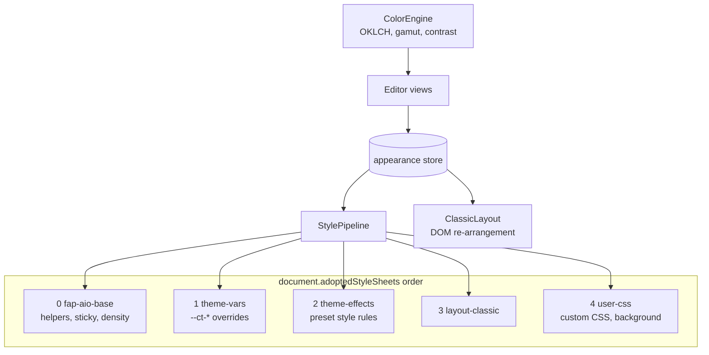

# Design Document

## Overview

The appearance module restyles and re-arranges FAP v2 pages. It has four parts:
- A style pipeline of layered constructable stylesheets.
- A theme system: presets, a colour engine, a CSS editor, import and export.
- A layout system: Classic FAP, compact, wide, sticky.
- Editor views in the panel.

It runs in the content script on the core from `v2-core-scheduler/design.md` and never changes FAP data or behaviour.

Inputs: `requirements.md`, [decision 0002](../../../docs/60-decisions/0002-v2-module-scope.md), the FAP CSP in `docs/20-architecture/fap-v2/platform.md`, the Jidox facts in `docs/70-work/investigations/2026-10-04-scheduler-comparison-and-v2-scope.md`, the route map, and the style traits from [Name That UI](https://namethatui.com/styles).

Research used:

| Topic | Finding | Source |
|---|---|---|
| Injecting CSS under `style-src 'self'` | Constructable stylesheets are CSSOM and are not blocked by `style-src`; `<style>` elements and `style` attributes in injected markup are | [WICG #98](https://github.com/WICG/construct-stylesheets/issues/98), [MDN style-src](https://developer.mozilla.org/docs/Web/HTTP/Headers/Content-Security-Policy/style-src) |
| `@import` in constructed sheets | Not supported by `replaceSync` (CSSOM spec; not re-checked this session). Imports are stripped in any case (R5.4) | CSSOM `replaceSync` definition |
| Harmony maths | Rotate hue in OKLCH with lightness and chroma held: complementary +180; analogous ±30; triadic +120/+240; split-complementary +150/+210; tetradic +60/+180/+240; square +90/+180/+270 | [Shademix OKLCH guide](https://shademix.com/guides/oklch-harmony-generator.html), [LogRocket OKLCH](https://blog.logrocket.com/oklch-css-consistent-accessible-color-palettes) |
| Contrast | WCAG AA 4.5:1 text, 3:1 large text and UI components; ratio (L1 + 0.05)/(L2 + 0.05) on relative luminance | WCAG 2.2 (W3C), via [LogRocket OKLCH](https://blog.logrocket.com/oklch-css-consistent-accessible-color-palettes) |
| Style traits | Glassmorphism: frosted translucent panels, vivid backdrop, thin light edge. Neumorphism: dual soft shadows, one surface, inset states. Frutiger Aero: glossy glass, sky-blue and grass-green. Liquid Glass: lensing, adaptive tint. Claymorphism: puffy shapes, two inner and one outer shadow, large radii | [Name That UI styles](https://namethatui.com/styles) |

## Architecture



### Early application (R1.1)

The appearance content script is a separate entry at `run_at: document_start`. It reads `appearance.active` from `chrome.storage.local`, which is asynchronous and usually under 10 ms. It then adopts the stylesheets on `document` before the body paints and sets `data-bs-theme`. A theme that arrives after first paint still applies without reload; the brief flash is accepted. The core panel entry stays at `document_idle`.

## Components and Interfaces

### StylePipeline (`src/features/appearance/pipeline.ts`)

```ts
type Layer = 'base' | 'vars' | 'effects' | 'classic' | 'user';
interface StylePipeline {
  set(layer: Layer, css: string | null): void;   // replaceSync on a persistent CSSStyleSheet
  apply(): void;                                  // document.adoptedStyleSheets = [...fapSheets, ...ours in layer order]
}
```

- Our sheets are appended after FAP's own adopted sheets, if any, and keep a stable order (R4.5).
- `vars` is generated as `html[data-bs-theme=light|dark] { --ct-...: ...; }` with higher specificity than Jidox's `:root` and `[data-bs-theme=dark]` rules (R1.2, R3.6).
- "FAP default" sets the theme layers (`vars`, `effects`, `user`) to null and restores the saved original `data-bs-theme` (R1.4). The `classic` and `dock` layers are layout and stay (D-6, 2026-11-17).
- No FAP storage is written; the original mode is kept in extension storage (R1.6).
- The panel's shadow root adopts a derived `panel-theme` sheet carrying the theme's mode and accent (R1.7).

### Theme model and presets (`themes/`)

```ts
interface Theme {
  formatVersion: 1;
  id: string; name: string; mode: 'light' | 'dark';
  roles: { primary: string; secondary: string; accent: string; surface: string; surfaceAlt: string; text: string; textMuted: string; border: string; success: string; warning: string; danger: string; info: string };
  vars: Record<string, string>;          // explicit --ct-* overrides on top of role mapping
  tokens: { radius: number; shadow: 'none' | 'soft' | 'dual' | 'clay' | 'glow'; blur: number; surfaceOpacity: number; fontFamily: string };
  effects: string;                        // preset style rules (generated, read-only for presets)
  background: { dataUrl: string; fit: 'cover' | 'contain' | 'tile'; dim: number } | null;
  css: string;                            // user CSS
  preset?: string;                        // id of the preset it came from
}
```

- Role to variable map (`role-map.ts`): each role sets a group of `--ct-*` names, for example `primary` sets `--ct-primary`, `--ct-primary-rgb`, `--ct-link-color` and the `--ct-btn-*` primary values. The map is generated from the 144 variables found in FAP's stylesheet and kept in a table with a test that every variable is covered or explicitly left alone.
- Presets (R2.1 to R2.3). Each is a `Theme` with roles and tokens plus an `effects` block scoped to FAP selectors (`.card`, `.btn`, `.table`, `.leftside-menu`, `.navbar-custom`/top bar, `.form-control`, `.dropdown-menu`, `.modal-content`). Gradients are CSS only, so no image is needed.

| Preset | Mode | Surfaces | Effects |
|---|---|---|---|
| Glassmorphism | light | white at 0.55 opacity over a vivid gradient body | `backdrop-filter: blur(14px) saturate(160%)`, 1 px white edge at 0.5 alpha, soft shadow |
| Neumorphism | light | single tone `#e8ecf1` | dual shadows `8px 8px 16px #c5c9cf, -8px -8px 16px #ffffff`; inset on `:active` and focused inputs; radius 16 |
| Minimalist White | light | `#ffffff`, hairline borders `#ececec` | no shadows, radius 6, generous padding, a single accent |
| Frutiger Aero Green | light | glossy white glass | sky-to-grass gradient body (`#bfe6ff` to `#b6f0a8`), top highlight gloss `linear-gradient(#fff9, #fff0)` on buttons, radius 12 |
| Frutiger Aero Blue | light | glossy white glass | aqua gradient body (`#d9f2ff` to `#7cc8ff`), gloss highlights, bubble accents |
| Liquid Glass | light | layered translucency | `backdrop-filter: blur(20px) saturate(180%)`, inner highlight `inset 0 1px 0 #fff8`, edge refraction with an inset gradient, accent tint from the primary role |
| Claymorphism | light | pastel independent cards | `inset -6px -6px 12px #0000001a, inset 6px 6px 12px #ffffffb3, 10px 14px 24px #0000001f`, radius 24 |
| Glassmorphism Dark | dark | `#000` body, panels white at 0.06 | blur 14 px, 1 px edge at 0.12 alpha |
| Minimalist Black | dark | `#000`, borders `#1f1f1f` | no shadows, a single accent |
| Liquid Glass Dark | dark | `#000`, glass white at 0.08 | blur 20 px, highlight `inset 0 1px 0 #ffffff26` |
| Claymorphism Vibrant Dark | dark | `#000` body, saturated clay cards | clay shadows tuned for dark, vivid role colours |

  Exact values are tuned during implementation. Every preset must pass the contrast test (R2.4).

### ColorEngine (`color/`)

- Conversions: sRGB ↔ linear ↔ OKLab ↔ OKLCH (Björn Ottosson's matrices), hex, rgb and hsl parsing (R3.1).
- `harmony(base, scheme)` rotates hue with L and C held (R3.2). `toGamut(color)` lowers chroma by bisection until it is inside sRGB, and marks it adjusted (R3.3).
- `contrast(a, b)` is the WCAG ratio. `fixLightness(fg, bg, target)` moves the foreground's OKLCH L away from the background until the ratio meets the target (R3.5).
- `assignRoles(palette, mode)`:
  - Base becomes primary; the next harmony colours become secondary and accent.
  - Surfaces come from the base hue: L 0.98 and C 0.01 in light mode; L 0 (true black) and L 0.14 for surfaceAlt in dark mode.
  - Text comes from `fixLightness` against the surfaces (R3.4).
- Curated swatches: 8 families (pastel, soft, muted, earthy, vivid, neon, deep, neutrals), 12 hues each, generated in OKLCH at fixed L and C bands and stored as constants (R3.1).

### CSS editor (`editor/CssEditor.tsx`)

- CodeMirror 6 with the CSS language, bundled. It runs inside the panel's shadow root; CodeMirror's own styles are adopted there (R4.1).
- Live preview: a 300 ms debounced parse into a scratch `CSSStyleSheet`. On success the `user` layer is replaced; on error the last valid CSS stays and the error line is marked (R4.3). `replaceSync` throws on syntax errors in some cases, but browsers also drop invalid rules silently. The editor therefore also runs a light parser (`csstree` validation in a worker) to report positions.
- Snippets: theme variables and the FAP selector list (R4.2).
- Background image: an `<input type=file>` reads the file; it is downscaled to at most 2560 px on a canvas, encoded as WebP or JPEG under 300 KB (D-6, 2026-11-17; was 1.5 MB), and stored as a data URL (R4.4).
- Safe mode: a setting flag; holding Shift during load is detected in the `document_start` script (R4.6).

### Import and export (`themes/io.ts`)

- Export: a `Theme` JSON downloaded through the service worker (R5.2).
- Import: JSON parse, then a schema check (zod), then sanitize the CSS:
  - drop `@import`;
  - remove `url(...)` unless it is a `data:` URL;
  - cap the size at 200 KB.
  The theme is then previewed with a notice before saving (R5.3, R5.4).
- Auto mode follows `matchMedia('(prefers-color-scheme: dark)')` and re-applies on change (R5.5).

### ClassicLayout (`layout/classic/`)

Jidox selector names used below (`.leftside-menu`, `.side-nav`, `.navbar-custom`, `.wrapper`, `.content-page`, `.weekly-timetable-cell`) come from the template and the recorded pages. Selectors not already in `pages.md` must be confirmed on live FAP before implementation (verification task).

DOM re-arrangement with a reversible log (R6.8):

```ts
interface Patch { apply(): void; revert(): void }
// examples: hide(el) via class, move(el, newParent) storing the original parent and nextSibling, insert(shadowHost)
```

- Navigation (R6.2, R6.3):
  - A shadow-rooted top bar inserted at the top of `.wrapper`.
  - The menu model comes from a static table (`classic-menu.ts`): each old category lists entries as `{ label, v2Route }`, built from `route-map.md`. At runtime it is joined with FAP's sidebar links (`.side-nav a[href]`), so labels come from FAP when present (R6.9) and unavailable routes are dropped.
  - The sidebar (`.leftside-menu`) is hidden with a class, not removed. Jidox's toggle state in `sessionStorage` is left untouched.
- Centred column: a classic layer rule sets `.content-page .container-fluid` to `max-width: 1140px; margin: 0 auto` and resets the sidebar offset (R6.4).
- Home directory (R6.5):
  - A shadow-rooted block before the home content, with sections from the same menu table.
  - Its deadline table reads `/Application/GetFormSchema?applicationTypeId=<id>` for the types listed on `/Application` (fields `deadline`, `registrationPeriodDisplay`), at most once a day and one request at a time, cached for 24 h. If the type list cannot be read, the table is hidden.
- Report pages (R6.6):
  - Detected by `#grade-report-term`/`#grade-report-course` or `#attendance-report-term`/`#attendance-report-course`.
  - Renders a tab strip from the term select's options and a card list from the course select's options.
  - A choice sets `select.value` and dispatches `change` with `bubbles: true`, so FAP's own `academic-report.js` loads the partial. The original selects are visually hidden but stay focusable for accessibility.
- Timetable (R6.7): a classic layer rule styles `.weekly-timetable-cell` by its attendance class (present, absent, not-yet) as cards with green, red or neutral borders. The text is not altered.
- Turning the setting off calls `revert()` on every patch in reverse order and clears the `classic` layer (R6.8).

### Density, width, sticky (`layout/tweaks.ts`)

Each option is a CSS fragment in the `base` layer, toggled by `html` classes `fap-aio-compact`, `fap-aio-wide` and `fap-aio-sticky`; classes avoid touching FAP's own attributes (R7.4, R7.5).
- Compact: table cell padding 0.25rem 0.5rem, line height 1.3, card body padding 0.75rem. Target: at least 25% more rows on `/Report/Transcript`, checked in manual verification (R7.1).
- Wide: `max-width: none` on Jidox containers (R7.2).
- Sticky: `thead th { position: sticky; top: var(--fap-aio-sticky-top) }` on `table.fap-sheet` and `table.student-mark-sheet`. The top offset is the measured top bar height, updated on resize (R7.3).

## Data Models

```ts
interface AppearanceState {
  schemaVersion: 1;
  active: { mode: 'single'; themeId: string } | { mode: 'auto'; light: string; dark: string } | { mode: 'fap-default' };
  themes: Theme[];                // custom themes; presets are code constants
  safeMode: boolean;
  layout: { classic: boolean; compact: boolean; wide: boolean; sticky: boolean };
  originalBsTheme: 'light' | 'dark' | null;
  classicCache: { deadlines?: { fetchedAt: number; rows: { type: string; deadline: string | null; period: string | null }[] } };
}
```

Background images live inside their theme. Storage use is bounded by the 1.5 MB image cap; `unlimitedStorage` is requested only if a user exceeds the 10 MB `chrome.storage.local` quota.

## Error Handling

- CSS parse errors are shown inline; the last valid CSS stays applied (R4.3).
- A broken or hostile import is rejected with the reason, and nothing is saved (R5.3).
- Remote `url()` and `@import` are stripped with a list of what was removed (R5.4).
- A Classic layout patch whose target is missing (FAP layout changed) is skipped. The other patches still apply, and the panel shows "Classic layout partly unavailable" with the missing parts.
- If FAP re-renders a region that a patch moved (partial swap), a `MutationObserver` re-applies the affected patch.
- Safe mode and the Shift key always recover from CSS that hides the panel (R4.6).

## Testing Strategy

- Unit tests:
  - ColorEngine: OKLCH round trips against reference values, harmony angles, gamut mapping, contrast ratio on known pairs (black and white 21:1), `fixLightness` convergence.
  - Presets: every role pair meets 4.5:1 for text and 3:1 for UI (R2.4).
  - Role map: covers the 144 `--ct-*` variables or lists exclusions.
  - Import sanitizer: `@import`, remote `url()`, `data:` allowed, size cap.
  - Classic patches: `apply` then `revert` restores the DOM byte-identically on fixtures of the FAP layout, home, grade report and timetable.
- Visual checks: Playwright screenshots of each preset and Classic layout on saved, anonymized FAP page fixtures served locally, with FAP's stylesheets copied from the live site for the fixture. A screenshot review is part of the release checklist.
- Manual verification on FAP: Classic report tabs drive FAP's own partial loads (grade and attendance); the panel is unaffected by themes; safe mode works; compact density row count on the transcript.

## Platform amendments

Added 2026-10-11: `.kiro/specs/v2-platform/design.md`, section "Amendments to approved designs", changes parts of this design (exports, data access, settings broadcast, permissions). Where they differ, the platform design applies; the text above is kept as approved.
