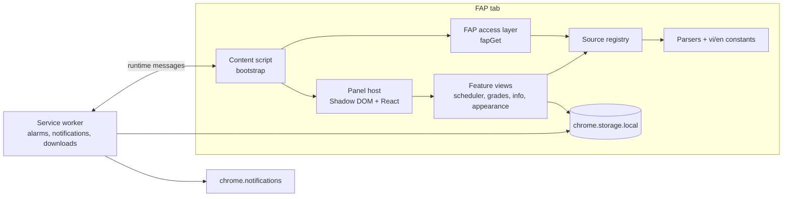

# Design Document

## Overview

FAP-AIO v2.0.0 is a Manifest V3 Chrome extension for the rewritten FAP portal (`https://fap.fpt.edu.vn`, FAP v2.0.0.0). This design covers the shared core (panel, FAP access layer, source registry, storage, settings, alarms) and the scheduler module (weekly timetable, exam schedule, views, calendar export, reminders, keep-alive, legacy cleanup) from `requirements.md`. The modules in `v2-grades`, `v2-info` and `v2-appearance` build on the same core.

Inputs: [decision 0001](../../../docs/60-decisions/0001-v2-extension-foundations.md), [decision 0002](../../../docs/60-decisions/0002-v2-module-scope.md), FAP v2 facts in `docs/20-architecture/fap-v2/` (platform, pages, endpoints, data-model, scripts), and the scheduler comparison in `docs/70-work/investigations/2026-10-04-scheduler-comparison-and-v2-scope.md`.

Key design decisions:

| Decision | Choice | Reason |
|---|---|---|
| Toolchain | Vite 5, React 18, TypeScript (strict), `@crxjs/vite-plugin`, Tailwind 3 | Same stack as the legacy build in `.deprecated/fap-aio/`; known to the owner |
| Panel isolation | Shadow DOM host appended to `document.body`; styles adopted as a constructable stylesheet (`CSSStyleSheet.replaceSync` + `shadowRoot.adoptedStyleSheets`) | FAP CSP is `style-src 'self'`; constructed stylesheets are CSSOM and not blocked by `style-src` ([WICG construct-stylesheets #98](https://github.com/WICG/construct-stylesheets/issues/98), [MDN style-src](https://developer.mozilla.org/docs/Web/HTTP/Headers/Content-Security-Policy/style-src)). Shadow DOM keeps panel CSS out of FAP and FAP CSS out of the panel (R1.6). Tailwind output is compiled at build time and imported as a string (`?inline`). |
| Where FAP is read | Content script on the FAP tab (same origin, session cookie) | Requests from the page origin carry the session cookie with no SameSite question; matches FAP's own scripts. The service worker never fetches FAP directly. |
| Timers | `chrome.alarms` in the service worker (minimum period 30 s from Chrome 120, [Chrome docs](https://developer.chrome.google.cn/docs/extensions/reference/api/alarms)); `minimum_chrome_version: "120"` | Survives service worker shutdown; reminders, keep-alive and background refresh share one scheduler |
| Work that needs FAP from a timer | Service worker sends a message to one open FAP tab; that tab's content script does the GET | Keep-alive and background refresh only matter while a FAP tab is open (R11.2) |
| Storage | `chrome.storage.local`, one key per store, each with `schemaVersion` | R5; never the FAP origin's storage (R5.2) |
| Request pacing | One request at a time, 400 ms pause, 1.5 s after an error, and a rolling budget of 30 FAP requests per 5 minutes per browser (shared through the service worker) | R3.8; bursts of about 110 and 53 GETs triggered a Cloudflare managed challenge (platform.md) |

## Architecture



Content script lifecycle on each FAP page:

1. `document_idle` on `https://fap.fpt.edu.vn/*`, top frame only.
2. Page guard: skip login (`/Auth/Login`), logout and 404 pages (R1.7). Detection is structural: absence of the authenticated layout root (`.content-page` inside the Jidox wrapper) and presence of the login form.
3. Load settings and panel state from storage, mount the panel host, register feature modules.
4. Resume any unfinished range sync (R6.6).
5. Announce the tab to the service worker (`tab-ready`) so timers can target it.

Service worker responsibilities: alarms (reminders, keep-alive, background refresh), notifications and their click handling (R10.4), downloads for exports, and routing alarm work to a live FAP tab (the most recently active one).

## Components and Interfaces

### Bootstrap (`src/content/index.ts`)

```ts
interface FeatureModule {
  id: 'scheduler' | 'grades' | 'info' | 'appearance' | 'settings';
  registerSources(reg: SourceRegistry): void;
  views: PanelView[];                    // tabs shown in the panel
  onPage?(ctx: PageContext): void;       // inline page enhancements (used by grades, appearance)
}
```

### Panel (`src/content/panel/`)

Layout, navigation, Today, command palette, alerts inbox, keybinds and the Settings view are specified in `.kiro/specs/v2-panel-ux/` (state schema v2, migration from the v1 state below). This section keeps the host mechanics.

- `PanelHost`: creates `<div id="fap-aio-root">`, attaches an open shadow root, adopts the compiled stylesheet, renders `<PanelApp>`.
- `PanelState`: `{ x, y, width, height, minimized, view }` persisted under `panel.state` on every change, debounced 250 ms (R1.4).
- Drag: pointer events on the header, clamped to the viewport (R1.2); on `resize` the saved rectangle is clamped again (R1.5).
- Minimized: a 40 px handle with the same position; click or Enter restores (R1.3).
- Accessibility: header is a `role="toolbar"`, views are `role="tablist"` with arrow-key navigation, all buttons have `aria-label`, focus stays inside the panel only while a dialog is open (R1.8).
- `z-index` 2147483000; the host has `all: initial` so FAP styles do not leak in.

### FAP access layer (`src/content/fap/access.ts`)

```ts
type FapResult<T> =
  | { ok: true; value: T; fetchedAt: number }
  | { ok: false; error: FapError };

type FapError =
  | { kind: 'session-expired' }
  | { kind: 'feedback-required'; url: '/Feedback?required=1' }
  | { kind: 'unavailable'; status: 404 }
  | { kind: 'challenge' }                 // Cloudflare managed challenge: 403 + cf-mitigated: challenge
  | { kind: 'forbidden'; status: 403 }
  | { kind: 'network'; message: string }
  | { kind: 'layout-changed'; source: string; detail: string };

function fapGet(path: string, opts?: { partial?: boolean; signal?: AbortSignal }): Promise<FapResult<Document>>;
```

- GET only, `credentials: 'same-origin'`, `redirect: 'follow'` (R3.1, R3.3).
- `partial: true` adds `X-Requested-With: XMLHttpRequest` (R3.2).
- Session check: final URL path starts with `/Auth/Login`, or the parsed document contains the login form (R3.5).
- `X-Feedback-Required: 1` header gives `feedback-required` (R3.4).
- 404 gives `unavailable`, never retried (R3.6). A 403 with the header `cf-mitigated: challenge` gives `challenge`: Cloudflare bot management has flagged the session (verified 2026-10-11, `platform.md`). It stops every queued and background read in the tab and is never retried. Any other 403 gives `forbidden`, never retried within the operation.
- The content script's `fetch` is the isolated-world native fetch, not FAP's `fapPermissionAwareFetch` wrapper, so headers and status arrive unmodified.
- Network failure: one retry after 1.5 s (R3.7).
- A single queue serializes all requests with a 400 ms gap (R3.8). The queue is per tab; the service worker routes timer work to one tab.

### Source registry (`src/content/fap/registry.ts`)

```ts
interface SourceDef<T> {
  id: string;                         // 'timetable.week', 'exam.list', ...
  route: (params: Record<string, string>) => string;
  partial: boolean;
  parse: (doc: Document, params: Record<string, string>) => T;  // throws LayoutChangedError
  cacheTtlMs: number;
  background?: { periodMin: number };  // used by v2-info background refresh
}
interface SourceRegistry {
  register<T>(def: SourceDef<T>): void;
  read<T>(id: string, params?: Record<string, string>, opts?: { force?: boolean }): Promise<FapResult<T>>;
}
```

`read` returns the cached value when it is younger than `cacheTtlMs` unless `force` (R4.2). Parser errors become `layout-changed` with the source id (R4.3).

Registered by this spec (R4.4):

| Id | Route | Partial | Parser output |
|---|---|---|---|
| `timetable.week` | `/WeeklyTimetable/WeekPartial?referenceDate=<yyyy-mm-dd>` | yes | `WeekResult` |
| `exam.list` | `/ExamSchedule` | no | `Exam[]` |

### Parsers and constants (`src/content/fap/parse/`)

- `constants.ts`: one table per text-valued field, keyed by normalized text (lowercase, NFC, trimmed), mapping to an enum, covering `vi` and `en` (R2.3). Attendance: `Present`/`Có mặt` → present, `Absent`/`Vắng mặt` → absent, `Not yet`/`Not taken`/`Chưa điểm danh` → not-yet, `Attendance exempt`/`Miễn điểm danh` → exempt. Unknown text → `{ kind: 'unknown', raw }` (R2.4). Values not yet observed on FAP are marked in the table with `verified: false`.
- Timetable parser: reads the week's dates from the column headers' `dd/MM` and the container's `data-reference-date` (pages.md). It rejects a response whose dates do not include the requested Monday (R6.4) and treats `.fap-empty-state` as an empty week (R6.5). It reads cells by class (`.weekly-timetable-cell-title`, time chip, room, lecturer, online flag, schedule type, `.weekly-timetable-attendance-status`) and the slot number from the row index. A cell without a readable `HH:mm-HH:mm` time is counted as unreadable (R6.10).
- Exam parser: `table.fap-sheet` on `/ExamSchedule`, columns by position (Date, Time, Room, Subject `CODE - Name`, Exam type, Publication date, Attendance note, Note) (R7.1). Type mapping: `FE`, `PE`, `2NDFE`, `2NDPE`, else `other` (R7.4). Empty, `-` or `TBA` room → `null` (R7.5).

### Scheduler (`src/features/scheduler/`)

- `SyncEngine`:
  - `syncWeek(date)` and `syncRange(start, end)`.
  - A range is a list of ISO Mondays stored as a `SyncJob` before the first request, so it can resume after a reload (R6.2, R6.6). Each finished week is written immediately, and progress is shown as done out of total.
  - Term presets fill the range: Spring Jan to Apr, Summer May to Aug, Fall Sep to Dec (R6.3).
  - The final report gives weeks synced, weeks failed and sessions added or updated (R6.7).
- Merge: key `code|date|start`; existing records get their mutable fields updated (R6.9).
- `ExamSync`: merge key `code|type|date` (R7.3). Exams missing from FAP stay; `past = date < today` (R7.2).
- Views (revised 2026-10-31 to `ui/schedule.html`; the previous text is in `.deprecated/2026-10-31-schedule-audit/design.md`):
  - `ClassesView` (`views/WeekView.tsx`): sync buttons, This week and All with counts, day headers, class cards (R8.1, R8.2).
  - `ExamsView`: sync button, Upcoming and Past with counts, type chips, exam cards with type and countdown tags (R8.3, R8.4).
  - Shared `Tag` and `Line` parts in `views/common.tsx` with the soft tint table (R8.5); cards wrap and never truncate (R8.6).
  - Empty states (R8.7); last-sync stamps in the status strip (R8.8).
- `IcsExporter`, pure (revised 2026-10-31 for the agreed Export form; the previous text is in `.deprecated/2026-10-31-export-audit/design.md`):
  - `VTIMEZONE` for `Asia/Ho_Chi_Minh` (UTC+7, no DST); `DTSTART;TZID=...` (R9.11).
  - UID `sha1(code|date|start[|type])@fap-aio`, independent of title and details (R9.12).
  - Text escaping (`\`, `;`, `,`, newline) and folding at 75 octets on UTF-8 boundaries (R9.13).
  - `selectForExport(timetable, exams, prefs, today)`: range (week, next 2 weeks, month, current term from `termOf`, custom), class mode and excluded subjects, exam types, no-room and past toggles (R9.3 to R9.5).
  - `classEvent` and `examEvent` build one event from a record and `ExportPrefs`: title format with the subject name looked up by code in the exam list (R9.6), details and location by the chosen chips (R9.7), `VALARM`s by the chosen offsets (R9.8). The preview renders the same event object (R9.9).
  - `buildIcs(events)` writes one calendar; three files (offline classes, online classes, exams) or one (R9.2). Titles join the chosen pieces with the separator, leaving out empty ones (R9.6); description lines follow the detail order and each event carries its kind's `CATEGORIES` (R9.7); one `VALARM` per reminder tier (R9.8).
  - The file is downloaded through an `a[download]` blob link inside the shadow root (platform amendment, no `downloads`).
- Export view (`views/ExportView.tsx`): layout A of `ui/schedule-audit.md` round S1, one scrolling form, groups numbered 1 to 8, "Remember my choices" and the pinned "Download .ics (N events)" button (R9.1, R9.9). Options persist in `export.prefs` only while "Remember my choices" is ticked (R9.10).
- `Reminders`, in the service worker:
  - On `sync-done` or a settings change, clear all `reminder:*` alarms and create one per class (15 or 30 minutes before) and per exam (1 day and 1 hour before), for items starting within 30 days (R10.2, R10.3). The cap of 500 active alarms (Chrome 117+) is respected by the 30-day window, and the nearest items are kept first.
  - Clicking a notification focuses a FAP tab on `/WeeklyTimetable` or `/ExamSchedule`, or opens one (R10.4).
  - Off by default (R10.1).

### Keep-alive (`src/background/keepalive.ts`)

Alarm `keepalive`, period 7 minutes by default (decision 0002; adjustable in settings, minimum 1). On fire, if a FAP tab is open, the service worker asks it to `fapGet('/Notification/UnreadCount')`; that route is small and returns JSON on every request mode (platform.md). On `session-expired` it clears the alarm, sets `keepAlive.enabled = false` and notifies the user (R11.3). Turning the setting off clears the alarm (R11.4). Off by default (R11.1).

### Legacy cleanup (`src/features/legacy/`)

- On a FAP page, scan `window.localStorage` keys against the legacy list and pattern (R12.1).
- If any exist, show a one-time banner inside the panel.
- Accept: build a JSON export, start the download, then remove only the matched keys (R12.2, R12.3).
- Decline: store `legacy.dismissed = true`; settings can reopen the offer (R12.4).

### Settings (`src/features/settings/`)

A panel view bound to the `settings` store; every control writes immediately and broadcasts `settings-changed`, so alarms and views update without reload (R13.1, R13.2).

## Data Models

```ts
// storage keys and versions
type StoreKey = 'panel.state' | 'settings' | 'timetable' | 'exams' | 'sync.job' | 'export.prefs' | 'legacy' | 'cache';

interface Versioned<T> { schemaVersion: number; updatedAt: number; data: T }

type Attendance = 'present' | 'absent' | 'not-yet' | 'exempt' | { kind: 'unknown'; raw: string };

interface Session {
  id: string;            // `${code}|${date}|${start}`
  date: string;          // yyyy-mm-dd
  slot: number;
  start: string;         // HH:mm as shown
  end: string;
  code: string;          // subject code
  group: string;         // class/group
  room: string | null;
  lecturer: string | null; // shortcode login, case preserved
  online: boolean;
  scheduleType: string | null;
  attendance: Attendance;
  syncedAt: number;
}

interface WeekResult { monday: string; empty: boolean; sessions: Session[]; unreadable: number }

type ExamType = 'FE' | 'PE' | '2NDFE' | '2NDPE' | 'other';
interface Exam {
  id: string;            // `${code}|${type}|${date}`
  date: string; start: string; end: string;
  room: string | null;   // null = not assigned
  code: string; name: string;
  type: ExamType; typeRaw: string;
  publishDate: string | null;
  attendanceNote: string; note: string;
  past: boolean; syncedAt: number;
}

interface SyncJob { kind: 'range'; mondays: string[]; next: number; failed: string[]; added: number; updated: number; unreadable: number; startedAt: number }

// export.prefs v2 (R9.10), stored only while `remember` is true; revised 2026-10-31 (round S3, F-7)
type ClassPiece = 'room' | 'code' | 'name' | 'group' | 'slot' | 'lecturer' | 'time';
type ExamPiece = 'room' | 'type' | 'code' | 'name' | 'format' | 'time';
interface ExportPrefs {
  classes: boolean; exams: boolean; files: 'separate' | 'one';   // separate: offline classes, online classes, exams
  range: 'week' | 'next2' | 'month' | 'term' | 'custom'; from: string | null; to: string | null;
  classMode: 'all' | 'offline' | 'online'; excludedSubjects: string[];
  examTypes: ExamType[]; examNoRoom: boolean; examPast: boolean;
  classTitle: { pieces: ClassPiece[]; sep: string };       // default room, code with ' - '
  examTitle: { pieces: ExamPiece[]; sep: string };         // default room, type, code with ' - '
  details: ('room' | 'lecturer' | 'slot' | 'group' | 'attendance' | 'format' | 'results')[];  // ordered
  categories: { offline: string; online: string; exam: string };
  classReminders: number[];   // minutes before, default [15, 120, 1440]
  examReminders: number[];    // default [30, 120, 1440]
  remember: boolean;
}
// Migration step export.prefs 1 to 2 maps split, title, classReminder and examReminders.

interface Settings {
  reminders: { enabled: boolean; classOffsetMin: 15 | 30 };
  exportReminders: { enabled: boolean; classOffsetMin: number };   // superseded 2026-10-31 by export.prefs (R9.8)
  keepAlive: { enabled: boolean; intervalMin: number };   // default false, 7
  background: { enabled: boolean; periodMin: number };    // v2-info, default true, 6
  legacy: { dismissed: boolean };
}
```

Migrations: `migrations[store][fromVersion] = (old) => new`. A missing step discards the store and shows "sync again" (R5.4). "Clear data" removes every key except `settings` after a confirmation dialog (R5.5).

## Error Handling

| Error | Where shown | Behaviour |
|---|---|---|
| `session-expired` | Panel banner, notification for timer work | Stop the operation; keep-alive disables itself; a range sync job stays resumable |
| `feedback-required` | Panel banner with a link to `/Feedback?required=1` | Stop the operation (R3.4) |
| `unavailable` (404) | Inline in the view | Not retried (R3.6) |
| `challenge` (Cloudflare) | Panel banner "FAP asked your browser to verify. Reload this page to continue." with a Reload button | Stop all reads in the tab; background refresh stops until the next `tab-ready`; never retried; the extension never interacts with the challenge |
| `forbidden` (403) | Panel banner | Stop the operation and back off: background refresh pauses for 15 minutes |
| `network` | Inline | Retried once (R3.7), then reported |
| `layout-changed` | Panel banner naming the source | Data is not overwritten; the last good copy is kept (R4.3) |
| Unknown constant | Value shown raw with an "unknown" marker | Logged once per value (R2.4) |
| Week rejected | Counted in the sync report as failed | Sync continues with the next week (R6.4) |

Errors are typed values, not exceptions, across module boundaries. Every view has empty, loading, error and data states.

## Testing Strategy

- Unit tests (Vitest, `linkedom` for DOM in Node, dev dependency only):
  - Parsers run against committed fixtures built from the recorded FAP v2 structure, with personal data replaced by placeholders. Each constant-table entry has a test in both cultures (decision 0001 consequence).
  - `IcsExporter`: escaping, 75-octet folding on multibyte text, UID stability, TZID.
  - `SyncEngine`: resume after interruption, rejection of a wrong week, empty week, merge rules.
  - Access layer with a mocked `fetch`: login redirect, 404, 403, network retry, feedback header, queue spacing.
- Integration: the panel mounted in a Shadow DOM test page; drag clamping, persistence round trip, keyboard navigation (Testing Library).
- Manual verification on FAP (owner session), recorded as a test-run document: one week sync in each culture (R2.5), a term range sync, an exam sync, an ICS import into Google Calendar, a reminder, keep-alive over 20 minutes.
- Accessibility check of the panel with axe-core in the integration tests.

## Platform amendments

Added 2026-10-11: `.kiro/specs/v2-platform/design.md`, section "Amendments to approved designs", changes parts of this design (exports, data access, settings broadcast, permissions). Where they differ, the platform design applies; the text above is kept as approved.
