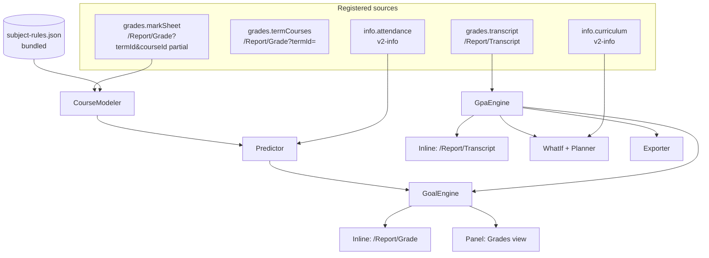

# Design Document

## Overview

The grades module adds GPA, pass checks, tier prediction, goals, a what-if simulator, a target planner and export to FAP-AIO v2.0.0. It runs on the core from `v2-core-scheduler/design.md` (access layer, registry, panel, storage). Its calculation code is a TypeScript port of the validated reference tools:
- `tools/flm-scraper/predict.mjs`: pass check, bonus, rounding, water-filling tier targets.
- `tools/flm-scraper/marksheet.mjs`: FAP mark sheet to course model.

The validation result is recorded in `docs/70-work/investigations/2026-10-10-flm-syllabus-scrape.md` and `docs/20-architecture/fap-v2/data-model.md`.

Inputs: `requirements.md`, `docs/10-context/constraints.md`, [decision 0002](../../../docs/60-decisions/0002-v2-module-scope.md), `docs/20-architecture/flm-subject-list.md`.

## Architecture



The engines are pure TypeScript with no DOM and no storage access. Parsers turn documents into records; engines turn records into results; views render results. Unit tests cover the engines directly.

## Components and Interfaces

### Sources (registered in the core registry)

| Id | Route | Partial | TTL | Output |
|---|---|---|---|---|
| `grades.transcript` | `/Report/Transcript` | no | 6 h | `TranscriptRow[]` (main table) and `ReplacedRow[]` (second table) |
| `grades.termCourses` | `/Report/Grade?termId=<guid>` | no | 6 h | `{ terms: Term[]; courses: CourseRef[] }` from `#grade-report-term` and `#grade-report-course` options |
| `grades.markSheet` | `/Report/Grade?termId=<guid>&courseId=<guid>` | yes (21% of the page, platform.md) | 30 min | `MarkSheetRow[]` via `rowsFromTable` and `{ code, title, meta }` from `.fap-result-card__*` |

Mark sheet reads follow the core queue (400 ms gap). The Grades view reads only the current term's courses, up to about 8 GETs; the 403 seen after about 110 GETs (data-model.md) is far away. Older terms are read on demand only, in the simulator or export.

### Transcript parser (`parse/transcript.ts`)

The transcript is the `.content-page table.fap-sheet` that has 10 columns; the replaced table has 7. Columns are read by position, never by header text. Status comes from the badge class plus constants: `bg-success` with text Passed or Đạt gives passed, `bg-success` with Exempt gives exempt, `bg-info` gives in-progress, and `bg-danger` gives not-passed (not observed; marked unverified in the constants). Grade comes from the `span.badge` number; `-` gives null.

### GpaEngine (`engine/gpa.ts`)

```ts
interface GpaInput { rows: TranscriptRow[]; nonGpa: string[] }
interface GpaResult {
  cumulative: number | null; credits: number;
  semesters: { name: string; order: number; gpa: number | null; credits: number; rows: string[] }[];
  counted: Set<string>;   // row ids
}
function isExcluded(code: string, list: string[]): boolean // code.toUpperCase().startsWith(e.toUpperCase())
```

Counted: status passed, numeric grade, credit > 0, not excluded (R2.1, R2.2, R2.6). Semester order: `year * 10 + {Spring: 1, Summer: 2, Fall: 3}` (R2.4). Display with `toFixed(2)` (R2.5).

### CourseModeler (`engine/course-model.ts`)

A port of `courseModel`:
- Match each FAP group to an FLM row. The score is token overlap (with FE, PE, TE, PT, lab, assignment and participation aliases, diacritics removed), plus 0.5 for equal weight and 0.25 for equal part count. The threshold is 0.5. The match score is exposed as `confidence` (R4.1, R4.9).
- Evenly weighted groups become one assessment with N parts. Unevenly weighted groups become a parent with child rows (R4.3).
- A graded resit replaces its base item (R4.4).
- Summary rows give `bonus`, `latePenaltyPercent` and `fapAverage`, `fapStatus` (R4.5, R4.10).
- With no items, use the FLM plan; with an unscored subject, report `unscored`; with neither FLM nor items, report `none` (R4.6 to R4.8).
- Rubric lookup tries `code`, then `code` without its last lowercase letter (R12.2).

### Predictor (`engine/predict.ts`)

A port of `predict` with the decision 0002 rounding:
- `final = min(scale, Σ w·score + bonus)`; `displayed = round1(final)`; pass and tier checks use `displayed` (R5.1).
- Component criteria: the FLM value, with an FE never below 4; progress rows default to > 0; a group criterion applies to the weighted average of its children (R5.2, R4.3).
- Pass mark: `minAvgMarkToPass ?? 5` (R5.3).
- Tier target: find the smallest uniform x in [0, 10] by bisection such that `known + bonus + Σ w·max(x, floor_i)` is at least `tier − 0.05`. The 0.05 allowance applies the display rounding; the comparison uses `round1` of the total. Round x up to a step of 0.1. Required per component: `max(x, floor_i)`. If the total at x = 10 is still short, the tier is not reachable (R5.4).
- Attendance: `maxAbsent = floor(total × (1 − minPercent/100))`; exceeding it is an issue, otherwise the remaining allowance is reported (R5.6).
- Coursera warning when `coursera.required` (R5.7). An assumed bonus of 1 when `coursera.bonus` and the user has ticked "MOOCs completed on time" (R5.8).

```ts
interface Prediction {
  status: 'failed' | 'passed' | 'in-progress' | 'unscored' | 'none';
  issues: string[]; warnings: string[];
  current: { weightedSoFar: number; gradedWeight: number; remainingWeight: number; bonus: number; assumedBonus: boolean };
  tiers: Record<TierId, { reachable: boolean; displayedFinal?: number; required?: { componentId: string; label: string; kind: string; min: number }[] }>;
}
```

### GoalEngine (`engine/goals.ts`)

- Effective course goal: the per-course tier if set, else the default tier (R7.1, R7.2).
- GPA goal G (R7.3):
  - Let `D` be the counted credits done and `P` the grade points done.
  - Let `K` be the in-progress GPA-counting courses, with credits `c_k` and highest reachable average `m_k` (the predictor's average with 10 on every remaining component, or the final average when complete).
  - Needed average: `a = (G·(D + Σc_k) − P) / Σc_k`.
- Distribution (R7.4): find a uniform `x` such that `Σ c_k · min(x, m_k) = a · Σc_k`, by bisection over x in [0, 10]. The target for course k is `min(x, m_k)`. Courses capped at `m_k` push the shortfall onto the others by construction.
- Unreachable when `Σ c_k·m_k < a·Σc_k`; the reported highest reachable GPA is `(P + Σ c_k·m_k)/(D + Σc_k)` (R7.5).
- Effective target per course: `max(tier value, GPA-derived target)`, with both shown (R7.6).

### Views

- `TranscriptSummary` (inline, R3):
  - Mounts in its own shadow root, inserted before the transcript card.
  - Counted rows get a `fap-aio-gpa-counted` class. A page-level constructable stylesheet (`document.adoptedStyleSheets`) styles that class. Cell contents are never edited (R3.2).
  - Links open the panel on the Grades view (R3.3).
- `GradeInline` (R6):
  - A `MutationObserver` on `#grade-report` with a 150 ms debounce re-reads the sheet when FAP swaps the partial (R6.3).
  - The block mounts in a shadow root after `table.student-mark-sheet`'s card.
  - A tier selector writes the course goal (R6.2).
- `GradesView` (panel, R8): term course list, a failed-first sort (R8.5), GPA header and goal status (R8.3), course drawer (R8.4), refresh state (R8.2), rubric date (R12.1).
- `WhatIf` and `Planner` (panel sub-views, R9, R10):
  - Inputs live in component state only; nothing is persisted (R9.4).
  - Planner credits default from the `info.curriculum` source: curriculum subjects not passed, excluding the non-GPA list (R10.2).
- `Exporter` (R11): CSV with a BOM and a header block (non-GPA list, export date), and JSON with the same content. Downloaded through the service worker.

### Settings added

`grades.defaultTier` (default `good`), `grades.nonGpa` (default list), `grades.courseGoals` (per course id), `grades.gpaGoal` (number or null), `grades.moocDone` (per course id, boolean).

## Data Models

```ts
type TierId = 'pass' | 'fair' | 'good' | 'excellent';
const TIERS: Record<TierId, number> = { pass: 5, fair: 7, good: 8, excellent: 9 };

interface TranscriptRow {
  id: string;             // `${semester}|${code}`
  term: number | null; semester: string; code: string; name: string;
  prerequisites: string | null; replaced: string | null;
  credits: number; grade: number | null;
  status: 'passed' | 'exempt' | 'in-progress' | 'not-passed' | { kind: 'unknown'; raw: string };
}
interface ReplacedRow { semester: string; code: string; name: string; credits: number; grade: number | null; status: TranscriptRow['status'] }

interface Term { id: string; name: string; current: boolean }
interface CourseRef { id: string; termId: string; label: string; code: string | null }

interface MarkSheetRow { kind: 'item' | 'group-total' | 'summary'; group?: string; name?: string; weight?: string; value?: string; label?: string; status?: string | null }

interface CourseModel {
  code: string | null; scored: boolean; minAvgMarkToPass: number;
  attendance: { minPercent: number }; coursera: { required: boolean; bonus: boolean };
  components: { id: string; label: string; kind: 'ongoing' | 'FE' | 'PE' | 'presentation' | 'resit'; parts: number; weight: number; weightPerPart: number; criterion: { value: number; inclusive: boolean }; parentId: string | null }[];
  scores: Record<string, (number | null)[]>;
  bonus: number; latePenaltyPercent: number; fapAverage: number | null; fapStatus: string | null;
  mapping: { group: string; flmCategory: string | null; confidence: number }[];
  flags: string[]; source: 'fap-marksheet' | 'flm-plan';
}
```

Stores: `grades.cache` (transcript, term courses, mark sheets with `fetchedAt`), `grades.settings` (the settings listed above). Both versioned (core R5.3).

## Error Handling

- The access layer errors from the core design apply unchanged.
- Transcript or mark sheet `layout-changed`: inline blocks show a notice and the panel keeps the last good data (R3.4).
- An unknown transcript status is shown raw and excluded from GPA (R1.4).
- A weak mapping or a flagged FLM subject is shown as a warning chip with a tooltip naming the group or the flag (R4.9).
- A non-zero late penalty is shown with the note "effect not modelled" (R4.10).
- An unreachable tier or goal is shown as "not reachable" with the highest reachable value (R5.4, R7.5, R10.3).

## Testing Strategy

- Engine unit tests (Vitest):
  - Golden cases from the 2026-10-10 validation. The 43 graded courses are kept as anonymized fixtures: marks kept, names of people removed, course ids replaced. Expected `displayed` average and pass or fail must match FAP for all of them, including the two failures with an average of 5 or more, the six bonus or resit cases and the unscored LAB211.
  - Rounding: 4.95 passes, 4.94 fails; tier bisection at the 0.05 boundary.
  - GoalEngine: a reachable distribution, a capped course and an unreachable goal, with the property that the derived targets reproduce G.
  - GpaEngine: case-insensitive prefix exclusion; Exempt and In progress not counted; the replaced table ignored.
- Parser tests: transcript in `vi` and `en` fixtures; mark sheets with summary rows only; uneven groups; resit groups.
- Integration: `GradeInline` reacting to a partial swap with `MutationObserver` (linkedom or happy-dom).
- Manual verification on FAP: the current term's Grades view against FAP pages, the transcript summary against a hand-calculated GPA, and an export opened in a spreadsheet.
