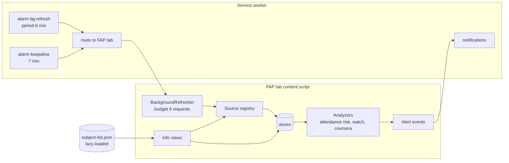

# Design Document

## Overview

The info module adds the panel's Info area (Overview, Subjects, Lecturers, Status, Exams, News) and a background refresh scheduler to FAP-AIO v2.0.0. It reuses:
- the core access layer, registry, storage, panel and alarms from `v2-core-scheduler/design.md`;
- the scheduler's session and exam stores;
- the grades module's course predictions (`v2-grades/design.md`).

New data comes from FAP pages (`/Report/Attendance`, `/Curriculum`, `/News`, `/Document`, `/Notification/*`) and the bundled FLM rubric (`data/flm/`).

Inputs: `requirements.md`, [decision 0002](../../../docs/60-decisions/0002-v2-module-scope.md), `docs/20-architecture/fap-v2/endpoints.md`, `pages.md`, `data-model.md`, `docs/20-architecture/flm-subject-list.md`.

## Architecture



## Components and Interfaces

### Sources (registered in the core registry)

| Id | Route | Partial | TTL | Background | Output |
|---|---|---|---|---|---|
| `info.unread` | `/Notification/UnreadCount` | json | 2 min | yes | `{ hasUnread: boolean }` |
| `info.bell` | `/Notification/BellList?pageIndex=1&pageSize=10` | yes | 10 min | no | `Notice[]` from `data-notification-*` |
| `info.news` | `/News?pageIndex=1&pageSize=20&SortBy=CreatedAt&IsDesc=true` | no | 10 min | yes | `NewsItem[]` |
| `info.newsDetail` | `/News/Detail/{guid}` | no | 7 d | yes (P1 only, at most 3 per cycle, within the 6-request budget) | `{ campus, expires, deadline, links, attachments }` |
| `info.documents` | `/Document?pageIndex=1&pageSize=20&SortBy=CreatedAt&IsDesc=true` | no | 6 h | no | `DocItem[]` |
| `info.attendance` | `/Report/Attendance?termId=&courseId=` | yes | 30 min | yes (current term) | `CourseAttendance` |
| `info.attendanceCourses` | `/Report/Attendance?termId=<current>` | no | 6 h | no | course refs from `#attendance-report-course` |
| `info.curriculum` | `/Curriculum` | no | 24 h | no | `CurriculumRow[]` |
| `exam.list` | (core) | | | yes | reused |

The JSON route goes through `fapGet` with a JSON variant (`fapGetJson`), the same queue and the same error mapping.

### BackgroundRefresher (`src/features/info/background.ts`)

- The service worker alarm `bg-refresh` fires with `periodInMinutes = settings.background.periodMin` (default 6, range 1 to 6; Chrome 120+ allows 30 s periods, so the range is safe). The service worker picks the most recently focused FAP tab and sends `bg-refresh`.
- Plan per cycle (R8.2, R8.3): `info.unread`, `info.news`, `exam.list`, then the current-term attendance courses in round-robin, up to a total of 6 requests. A course cursor persisted in storage ensures every course is refreshed within ceil(courses / 3) cycles.
- On 403: store `bg.pausedUntil = now + 15 min` (R8.4). On session expiry: stop until the next `tab-ready` (R8.5).
- Each refresh records `lastFapRequestAt`. The keep-alive alarm handler skips its ping when `now − lastFapRequestAt < 7 min` (R8.7). Keep-alive keeps its own setting and 7-minute period (core R11).
- After each cycle the analyzers run and emit alert events.

### Analyzers (`src/features/info/analyze/`)

- `attendanceRisk(courseAttendance, flmSubject)`: `allowed = floor(total × (1 − minPercent/100))`, `left = allowed − absent`, level `safe | warning | last-chance | failed` (R4.2, R4.3). `total` is the number of rows in the course's attendance table; this includes not-yet sessions, so it is the planned total.
- `newsClassifier(item, rules, ctx)` (R7.4 to R7.9):
  - `rules` is `data/news/news-rules.json`, bundled. `ctx` holds the student's subject codes (timetable and transcript), Coursera subjects, thesis enrolment (`*490` to `*492` in progress), cohort and campus.
  - Steps: normalize the title (NFD, diacritics removed, `đ` to `d`, lowercase); detect tag, families, flags (each flag raises the priority by one level), term tokens and title deadline; apply the personalization rules; apply user watch keywords (a match means P1).
  - The output is `{ tag, families, priority, deadline, campus?, reposted, personal: string[] }`.
  - A detail read (`info.newsDetail`, budget 3 per cycle) fills `campus`, `expires` and `deadline` from the body phrasings in the convention. Dedupe uses the key `normalizedTitle`, with a 30-day window.
  - `tools/news/analyze-news.py` is the reference implementation for the title step; the TypeScript port must give the same classification on the committed fixture of anonymized titles.
- `courseraDue(currentCourses, exams, flm, userChecks)` emits a warning for each Coursera course with an unchecked item and a synced FE (R5.3).
- Alert dedupe: key `${kind}|${itemId}|${level}` stored in `info.alerted` (R9.3).

### Lecturer directory (`src/features/info/lecturers.ts`)

- Collect from the timetable `Session.lecturer` and attendance rows (R3.1). Key `shortcode.toLowerCase()` (R3.2). Keep the most recent casing seen for display.
- Pattern check `/^[A-Za-z]+\d*$/` after trimming, with at least two uppercase letters in the original casing, or an all-lowercase mail form. A value failing the check gets no derived addresses (R3.6).
- Emails: `${display}@fe.edu.vn` (preferred) and `${display}@fpt.edu.vn` (R3.3). Mail-to links use `href="mailto:..."`; copying uses `navigator.clipboard.writeText` from the panel (R3.4).
- User data: `info.lecturerNotes[key] = { displayName, note }` (R3.7).

### Subjects (`src/features/info/subjects.ts`)

- The full rubric `data/flm/subject-list.json` (about 10 MB) is packaged as a web-accessible extension resource. It is loaded on first open of the Subjects section with `fetch(chrome.runtime.getURL(...))` and kept in memory for the tab's lifetime. The compact `subject-rules.json` (bundled for grades) backs search before the full file loads.
- Search: a prefix index on code plus a token index on English and Vietnamese names, diacritic-insensitive (R2.1).
- Detail: rendered from the full entry (R2.2), with links (R2.3), curriculum term and transcript status from `info.curriculum` and `grades.transcript` (R2.4), and flags with explanations from the scraper README table (R2.6).
- Learning path: build a graph from FLM `prerequisites.codes` and the curriculum's Prerequisites column. Show ancestors to depth 5 and direct dependents. A cycle is guarded by a visited set (R2.5).

### Views

Overview, Subjects, Lecturers, Status, Exams and News are React components in the panel's Info tab. Each section uses the shared `useSource(id)` hook, which provides loading, error and data states, a last-refreshed stamp and a refresh action (R1.4). Overview cards deep-link by setting `panel.state.view` and a section anchor (R1.3).

### Settings added

- `background.enabled` (default true) and `background.periodMin` (default 6, 1 to 6).
- `info.notify`: `{ attendance: false, news: false, coursera: false }`.
- `info.watchKeywords` (default empty; the rules file covers common events).
- `info.courseraDone` (per course).
- `info.lecturerNotes`.
- `news.seen` (ids, capped at 2,000).

### Capstone project (INF-7, added 2026-11-22)

- Source `info.account` on `/Account`, cache 6 hours, user priority when Info opens (no background read).
- Parser `parseCapstone(doc)`: finds `div.student-profile-field` elements whose icon is `i.ri-lightbulb-line`, `i.ri-translate-2` or `i.ri-edit-line` and reads `.student-profile-field__value`; values of "-" or empty count as absent; the updated date `dd/MM/yyyy` becomes ISO. Returns `null` when neither title is present. Label text is kept only for display fallbacks, never used to find a field (Requirement 10.1).
- View: a small "Capstone project" card at the top of Info, Subjects: English title, Vietnamese title (lang="vi"), "Updated <date>"; hidden when the parser returns `null` or the read fails (Requirement 10.2, 10.3).
- Fixtures: `test/fixtures/en/account-capstone.partial.html` (synthetic) and a "-" variant built in the test.

## Data Models

```ts
interface Notice { id: string; linkUrl: string; sourceCode: string; isRead: boolean; title: string; time: string }
interface NewsItem { id: string; title: string; type: string; createdAt: string; expiresAt: string | null; pinned: boolean; url: string }
interface DocItem { id: string; name: string; type: string; createdAt: string; url: string }
interface CourseAttendance {
  courseId: string; termId: string; code: string; group: string;
  rows: { date: string; slot: number; room: string; lecturer: string | null; status: Attendance }[];
  total: number; absent: number; notYet: number; exempt: number;
}
interface CurriculumRow { no: number; code: string; name: string; term: number; prerequisites: string[]; replacements: string[] }
interface Lecturer { key: string; display: string; validShortcode: boolean; subjects: { code: string; group: string }[]; lastSeen: string; emails: string[] }
type RiskLevel = 'safe' | 'warning' | 'last-chance' | 'failed';
interface AlertEvent { kind: 'attendance' | 'news' | 'coursera'; itemId: string; level: string; title: string; section: string }
```

Parsers:
- Attendance: `table.attendance-session-sheet`, with status from the class `.attendance-status--<state>` (`present`, `absent`, `pending`, `exempt`); no text matching is needed.
- News: the `/News` list table by column position; the detail id comes from the `/News/Detail/{guid}` link.
- Bell: `data-notification-*` attributes.

## Error Handling

The core error kinds apply, including the Cloudflare `challenge` kind (see the core design). In addition:
- An attendance course missing from the current term list is skipped and logged once.
- A watch keyword list that is empty after edits shows a hint that no news will be marked important.
- If the full FLM file fails to load, Subjects falls back to the compact rubric (assessments and credits only) with a notice.
- A background cycle that hits a `layout-changed` error skips that source until the next page load and shows the notice in the Overview.

## Testing Strategy

- Unit tests:
  - `attendanceRisk` boundaries (20 sessions at 80%: 4 allowed, levels at 2, 1, 0 and −1 left; 100% subjects).
  - `newsClassifier` on an anonymized fixture of the 600 titles from 2026-10-11 (expected output generated by `analyze-news.py`): every title classified, the priority counts match, deadlines are parsed in `dd/mm/yyyy`, and personalization moves other-campus items to P4.
  - Lecturer key normalization and pattern check (`DanhNT14`, `anhnd3`, invalid values).
  - Learning-path cycle guard.
  - BackgroundRefresher budget, round-robin cursor, 403 pause, keep-alive skip rule.
- Parser tests with anonymized fixtures of the attendance partial, the news list, the bell list and the curriculum.
- Integration: the Overview built from seeded stores, and deep links.
- Manual verification on FAP: a background cycle observed in the network log (at most 6 requests, 400 ms apart), attendance counts against FAP's own summary, and a watched-news alert with a test keyword.

## Platform amendments

Added 2026-10-11: `.kiro/specs/v2-platform/design.md`, section "Amendments to approved designs", changes parts of this design (exports, data access, settings broadcast, permissions). Where they differ, the platform design applies; the text above is kept as approved.
