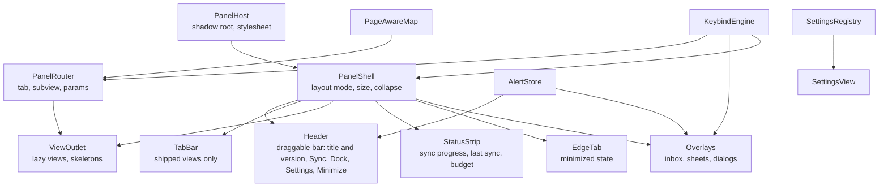

# Design Document

## Overview

This design gives the panel its layout and interaction model:
- a floating and docked hybrid;
- four primary tabs with segmented sub-views;
- the Today view, page-aware selection and an alerts inbox (the command palette was removed on 2026-10-26);
- customizable keybinds and a registry-driven Settings view.

It replaces the panel section of `v2-core-scheduler/design.md` for layout, which keeps the host mechanics: Shadow DOM, constructable stylesheet, persistence and clamping. All feature views plug in through registries, so modules stay independent.

Research used:

| Topic | Guidance applied | Source |
|---|---|---|
| Tabs | Few tabs, 1 to 2 word labels, no all caps, clear selected state; tabs for sibling views at one level | [NN/g, Tabs Used Right](https://www.nngroup.com/articles/tabs-used-right/), [Material 3 tabs](https://m3.material.io/components/tabs/guidelines) |
| Navigation in a compact pane | Tabs or a bar in compact widths; a rail for 3 to 7 destinations in wider panes | [Material 3 navigation rail](https://m3.material.io/components/navigation-rail/guidelines) |
| Keyboard tabs | Arrow keys move, Home and End jump, Space or Enter activates; manual activation when panels fetch data | [WAI-ARIA APG Tabs](https://www.w3.org/WAI/ARIA/apg/patterns/tabs/) |
| Target size | At least 24 by 24 CSS px (WCAG 2.2 SC 2.5.8) | [WCAG 2.2](https://www.w3.org/TR/WCAG22/) |
| Legacy lessons | Main tabs with sub-tabs and counts, persistent progress bar, actions next to data (legacy `fptu-panel`); a drawer for long lists (legacy redesign) | `.deprecated/fap-aio/src/contentScript/features/scheduler/ui.ts`, `.deprecated/SCHEDULER_REDESIGN_SUMMARY.md` |

## Architecture



## Layout

Agreed with the owner on 2026-10-26 (gate G-UI-SHELL). The interactive visual is [`ui/shell.html`](ui/shell.html); the rounds are in [`ui/shell-audit.md`](ui/shell-audit.md). The earlier layout text is in [`.deprecated/2026-10-26-shell-audit/design.md`](.deprecated/2026-10-26-shell-audit/design.md).

```text
+--------------------------------------------------+
| FAP-AIO                    sync  dock  gear   -  |  header 50 px, the whole bar drags (buttons excluded)
| v2.0.0                                           |  version from the manifest as subtext
| Classes   |   Exams   |   Export                 |  tabs of shipped views only (R2.1, R2.2)
|--------------------------------------------------|
|  view content (scrolls)                          |
|--------------------------------------------------|
| Synced 2 min ago             [=====>    ] 6/17   |  status strip 34 px, always shown (R2.6)
+--------------------------------------------------+
```

Floating mode (R1.1, R1.2, R1.4, R1.7):
- Default 400 by 600 px at the bottom-right corner, 8 px from the edges. Limits 320 to 720 px wide, 400 px to the viewport height.
- Dragging the header moves the panel inside the viewport only; a viewport edge within 10 px snaps the panel to it.
- Eight resize zones: 6 px edges and 12 px corners with `ns`, `ew`, `nwse` and `nesw` cursors. Resizing stays inside the viewport and snaps the same way.

Docked mode (R1.1, R1.3 to R1.5, R1.9):
- Full height against the right edge, 400 px by default, 320 to 640 px, resized from a 6 px left edge.
- Dragging the header more than 48 px to the left undocks at the pointer.
- The setting "When docked" chooses Narrow the page (default) or Cover the page. Narrowing adopts a document stylesheet (CSSOM, allowed by FAP's CSP) that sets `margin-right` on `body` and `right` on Jidox's fixed `.navbar-custom` and `.footer` to `--fap-aio-dock-w`. The selectors are checked on live FAP in the M1 browser check (part of G-SELECTORS).
- Below 900 px of viewport width the docked panel is an overlay drawer with a 40% scrim that closes on Escape or a click outside, and the page is not narrowed.

Minimized (R1.6): a 32 by 100 px vertical tab with a grip and the label FAP-AIO on the right edge. A vertical drag moves it (position stored in `panel.state.edgeTabTop`); a click without movement reopens the panel, floating at the bottom-right corner with its last size, or docked.

Settings (R2.4) opens as a full view in the panel body with a back arrow; the tabs are hidden while it is open, the header and the status strip stay.

Density tokens:

| Token | Comfortable | Compact |
|---|---|---|
| Body text | 14 px / 1.5 | 13 px / 1.4 |
| Small text | 12 px | 11.5 px |
| Control height | 32 px | 28 px |
| Row padding | 8 × 12 px | 4 × 8 px |
| Section gap | 16 px | 10 px |
| Hit area minimum | 24 × 24 px | 24 × 24 px |

Colour and type come from the active theme through panel variables. The panel derives `--aio-surface`, `--aio-surface-alt`, `--aio-text`, `--aio-text-muted`, `--aio-border`, `--aio-accent`, `--aio-success`, `--aio-warning` and `--aio-danger` from the theme roles (`v2-appearance`). Its own contrast is checked against the same WCAG thresholds. The font is the system UI stack, with Vietnamese diacritics verified. Icons are Tabler outline, bundled as an SVG sprite inside the shadow root, so no font load runs against the page CSP.

## Components and Interfaces

### PanelRouter (`src/content/panel/router.ts`)

```ts
type TabId = 'today' | 'schedule' | 'grades' | 'info';
type Route =
  | { tab: 'today' }
  | { tab: 'schedule'; sub: 'week' | 'exams' | 'export'; params?: { date?: string } }
  | { tab: 'grades'; sub: 'courses' | 'gpa' | 'whatif' | 'planner'; params?: { courseId?: string } }
  | { tab: 'info'; sub: 'subjects' | 'lecturers' | 'news' | 'status'; params?: { id?: string } }
  | { overlay: 'theme' | 'settings' | 'help' | 'shortcuts'; section?: string };
interface PanelRouter { current(): Route; go(r: Route, opts?: { source: 'user' | 'page' | 'deeplink' }): void; back(): void }
```

The route persists in `panel.state.route`. Deep links from Today and the inbox call `go(..., { source: 'deeplink' })` (R3.2).

### View registry

```ts
interface ViewDef {
  tab: TabId; sub?: string; label: string; icon: string;
  component: () => Promise<React.ComponentType>;   // lazy chunk
  count?: () => number | null;                     // segmented-control badge (R2.2)
}
```

Modules register views:
- Scheduler: Schedule Week, Exams, Export.
- Grades: Courses, GPA, What-if, Planner.
- Info: Subjects, Lecturers, News, Status.
- Today: composed from `TodayProvider`s.

Views load lazily. The previous view stays mounted until the next one is ready, so the switch stays under 100 ms with cached data (R10.6).

Tabs follow the APG manual-activation model: arrows move focus, and Enter or Space activates, because views may trigger reads. Mouse click activates directly (R2.5, R10.4).

### Today (`src/content/panel/today/`)

```ts
interface TodayProvider { id: string; order: number; items(ctx): TodayItem[] }
interface TodayItem { id: string; title: string; detail?: string; tone: 'neutral' | 'warning' | 'danger' | 'success'; when?: string; link: Route }
```

Providers in R3.1 order: `nextClass` (scheduler), `todayClasses` (scheduler), `examsSoon` (scheduler), `attendanceRisk` (info), `gradeRisk` (grades), `newsP1` (info), `courseraDue` (info). Empty providers are omitted (R3.3). Refresh triggers each provider's sources through the core registry, which applies the request budget (R3.4).

### PageAwareMap (`src/content/panel/page-aware.ts`)

A table of `pathname` regexes to `Route`, as in R4.1. It runs once per page load if the setting is on, and gets the course from `#grade-report-course` on the grade page. A user selection made afterwards wins until the next load (R4.2).

### Command palette

Removed 2026-10-26 (decision D-3, requirement 5). The earlier design is in [`.deprecated/2026-10-26-shell-audit/design.md`](.deprecated/2026-10-26-shell-audit/design.md).

### KeybindEngine (`src/content/panel/keys.ts`)

```ts
interface ActionDef { id: string; title: string; default: { win: string; mac: string }; scope: 'page' | 'global'; run(): void }
type Keybind = string;   // normalized 'Ctrl+K', 'Alt+Shift+F', '?'
```

- One `keydown` listener on `window` in capture phase. It is ignored when `event.isComposing`, or when the target or the shadow root's active element is an input, textarea, select or contenteditable. The exception is the toggle action (R7.5).
- Platform comes from `navigator.userAgentData?.platform ?? navigator.platform`; macOS defaults use Cmd and Ctrl as listed in R7.1.
- Recording: the settings row enters capture mode and builds the chord from `event.key`/`code` and the modifiers. It validates against the reserved browser list (Ctrl or Cmd plus T, W, N, Shift+N, Tab, Shift+Tab, L, D, F4 and similar; kept as a table) and against the other actions (R7.3).
- The global toggle uses `chrome.commands` (`toggle-panel`, suggested `Alt+Shift+F`). Settings shows `chrome.commands.getAll()` output and links to `chrome://extensions/shortcuts` (R7.4).
- Storage: `panel.keybinds` holds overrides only; defaults come from code, so new actions get defaults (R7.2).

### AlertStore and inbox (`src/content/panel/inbox/`)

```ts
interface Alert { id: string; kind: 'attendance' | 'news' | 'coursera' | 'grade' | 'reminder' | 'sync' | 'session' | 'challenge'; title: string; detail?: string; at: number; link?: Route; read: boolean; dedupeKey: string }
```

- Producers are the existing analyzers and engines; they call `alerts.push()`. The service worker mirrors new alerts to `chrome.notifications` only for kinds enabled in settings (R6.5).
- Retention: at most 200 alerts and 60 days, pruned on write (R6.4). Dedupe uses `dedupeKey`, which replaces `info.alerted` (v2-info design).
- Inbox UI: a popover under the bell; a list with kind filters; "Mark all read"; each row deep-links (R6.2, R6.3).

### SettingsRegistry and Settings view (`src/content/panel/settings/`)

```ts
interface SettingDef<T> {
  key: string;                         // 'schedule.reminders.enabled'
  section: 'general' | 'schedule' | 'grades' | 'info' | 'session' | 'appearance' | 'shortcuts' | 'data' | 'about';
  label: string; description: string;  // one line, sentence case (R8.3)
  type: 'toggle' | 'select' | 'number' | 'list' | 'text' | 'custom';
  default: T; options?: { value: T; label: string }[]; min?: number; max?: number;
  validate?(v: T): string | null;
  component?: () => Promise<React.ComponentType>; // custom rows: keybinds, non-GPA list, data export
}
```

- Every module declares its settings here, which removes the scattered settings lists in the other designs. The view renders sections in R8.1 order, with a sticky section index on the left (docked) or a select on top (floating).
- Search filters on label, description and key (R8.2).
- Each row shows its default and a "modified" dot; changes save at once and broadcast `settings-changed` (R8.3).
- Export and import: JSON `{ formatVersion: 1, settings: { key: value } }`. Import validates with each `SettingDef.validate`, then shows a diff (key, old value, new value) before applying (R8.4).
- Reset: section or all, with a confirmation dialog (R8.5).
- Data and privacy section: a storage usage meter (`chrome.storage.local.getBytesInUse`), a list of stores with sizes, "Export all data", "Clear data" (core R5.5) and legacy cleanup (core R12).

### First run (`src/content/panel/welcome/`)

The `panel.firstRun` flag. Three steps in a dialog inside the docked panel:
1. A tour of the four tabs, with one sentence each.
2. "Sync this week" as a primary button, running the scheduler sync with live progress.
3. Optional features listed with toggles, all off.

"Skip" is available on every step; finishing or skipping sets the flag. Help reopens the welcome (R9).

### StatusStrip

It shows the last sync time of the current tab's main source and the progress of any running sync job (from the legacy progress bar). After a `challenge` it shows the reload banner, and while a background pause is active it shows the remaining budget.

### Sticky view headers (F-23, added 2026-11-22)

- Settings: a sticky header at the top of the scrolling view holds the search box (with Export, Import and Reset all) and a wrapping row of section tabs. A tab scrolls its section heading into view below the header (scroll margin equal to the header height); an IntersectionObserver over the section headings marks the tab of the section nearest the top. The row wraps, so no tab is cut off at 320 px. The sticky index column and the floating "Go to section" select of PNL-8.1 are replaced by the tab row. Requirement 11.1 to 11.3.
- Theme view: the "In use" line, the mode chips and the preview bar form a sticky header. Info Subjects: the search box is sticky. Requirement 11.4.

## Data Models

```ts
interface PanelState {
  schemaVersion: 2;                     // v1 was { x, y, width, height, minimized, view }
  mode: 'floating' | 'docked';
  floating: { x: number; y: number; width: number; height: number };
  dockedWidth: number;
  collapsed: boolean;                   // pill or rail
  route: Route;
  density: 'comfortable' | 'compact';
}
interface PanelPrefs { pageAware: boolean; keybinds: Record<string, string>; recents: string[]; firstRun: 'pending' | 'done'; docked: 'narrow' | 'cover' }
// PanelState also gains edgeTabTop?: number (px from the viewport top) for the minimized tab.
```

Migration from core `panel.state` v1: keep x, y, width, height and minimized; map `view` to `route`; mode is `floating`.

## Error Handling

- A view chunk that fails to load shows an inline error with "Try again"; the rest of the panel works.
- A keybind conflict or reserved chord is refused with the conflicting action named (R7.3).
- A settings import with invalid values lists each rejected key and applies nothing until confirmed.
- If the dock layer's target selectors are missing (FAP layout changed), docking falls back to overlay mode with a notice. FAP content is never covered without the user knowing.
- A Cloudflare challenge or an expired session shows in the status strip and the inbox, and Today stops refreshing.

## Testing Strategy

- Unit tests:
  - router persistence and migration from v1;
  - page-aware mapping table;
  - keybind normalization, conflict detection and the input-focus guard;
  - alert dedupe and retention;
  - settings registry validation and import diff.
- Component tests (Testing Library):
  - tab keyboard model (arrows, Home, End, Enter);
  - dock snap thresholds with simulated pointer events;
  - collapsed pill and rail;
  - skeleton to content without layout shift.
- Accessibility: axe-core on every view in both densities; focus visible on every control; 24 px target audit; `prefers-reduced-motion` disables transitions.
- Manual verification on FAP:
  - dock and undock on the timetable, grade and home pages, with FAP content not covered;
  - overlay mode below 900 px;
  - keybinds in Chrome on Linux, Windows and macOS;
  - first-run flow.

## Platform amendments

Added 2026-10-11: `.kiro/specs/v2-platform/design.md`, section "Amendments to approved designs", changes parts of this design (exports, data access, settings broadcast, permissions). Where they differ, the platform design applies; the text above is kept as approved.
