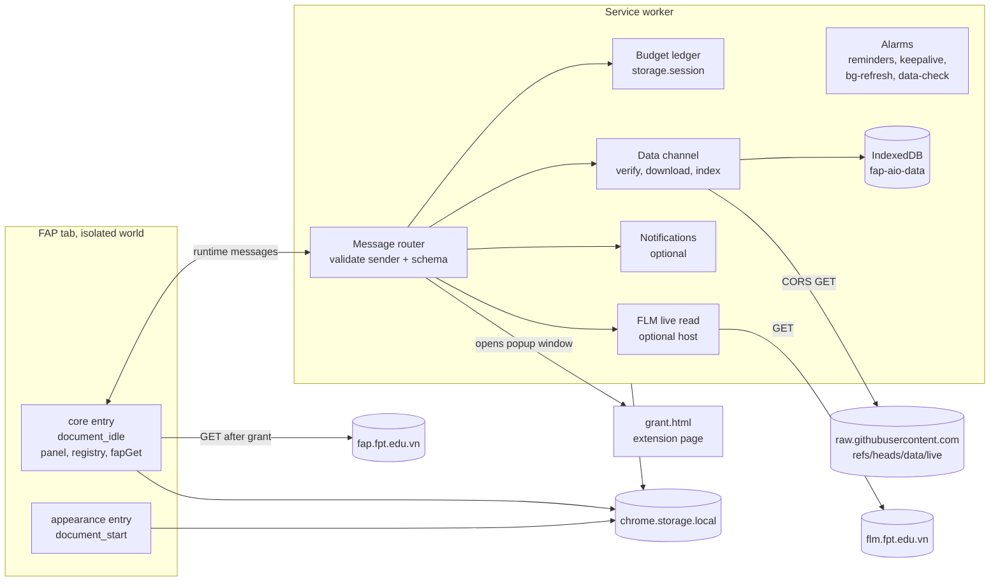
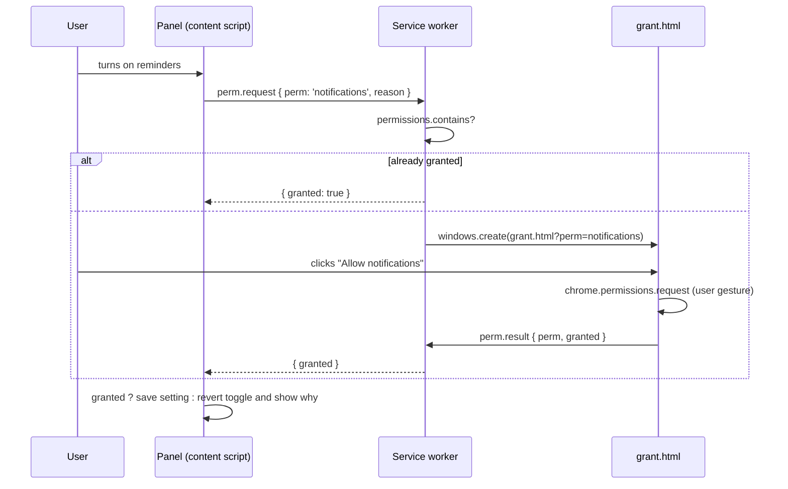

# Design Document

## Overview

This design defines the platform under the five feature specs:
- the manifest;
- the message contract and the shared request budget;
- storage and the data channel;
- privacy and security;
- fixtures;
- build and release.

Where it changes an approved feature design, the change is listed in "Amendments to approved designs" at the end, and a pointer to that section is appended to the affected design.

Inputs: `requirements.md`, decisions [0001](../../../docs/60-decisions/0001-v2-extension-foundations.md) to [0004](../../../docs/60-decisions/0004-v2-platform.md), `docs/20-architecture/fap-v2/platform.md` (CSP, Cloudflare), the five feature designs.

Facts checked on 2026-10-11:

| Fact | Consequence | Source |
|---|---|---|
| Content scripts can use only `dom`, `i18n`, `storage` and `runtime` messaging, `getURL`, `getManifest` and `id` | Permissions, notifications, commands, alarms and IndexedDB data go through the service worker | [Chrome content scripts](https://developer.chrome.com/docs/extensions/develop/concepts/content-scripts) |
| A content script `fetch` of its own packaged file needs `web_accessible_resources` | Packaged data is read by the service worker, not by content scripts, so no resource is web accessible | same page |
| `alarms`, `storage`, `unlimitedStorage`, `scripting` show no install warning; `downloads` shows "Manage your downloads", `notifications` shows "Display notifications", `tabs` shows "Read your browsing history" | Install shows only the FAP site access | [Chrome permissions list](https://developer.chrome.com/docs/extensions/reference/permissions-list) |
| `notifications` and host permissions can be optional; `permissions.request()` needs a user gesture | A small extension page asks for them after a click | [chrome.permissions](https://developer.chrome.com/docs/extensions/reference/api/permissions) |
| `raw.githubusercontent.com` answers with `access-control-allow-origin: *`, gzip, `cache-control: max-age=300`, and serves `/<owner>/<repo>/refs/heads/<branch>/<path>` | The service worker can read the data channel with plain CORS, no host permission | `curl -I`, 2026-10-11 |
| `subject-list.json` is 10,301,073 bytes, 1,659,268 gzipped; `subject-rules.json` 1,198,605, 69,575 gzipped | A full channel update moves about 1.7 MB | local `gzip -c | wc -c` |
| `chrome.storage.local` holds 10 MB without `unlimitedStorage` | The full list cannot live there | [chrome.storage](https://developer.chrome.com/docs/extensions/reference/api/storage) |

## Architecture



## Manifest

Generated by `src/manifest.ts` (`defineManifest` from `@crxjs/vite-plugin`, as in `.deprecated/fap-aio/src/manifest.ts`):

```json
{
  "manifest_version": 3,
  "name": "FAP-AIO",
  "version": "2.0.0",
  "minimum_chrome_version": "120",
  "icons": { "16": "img/logo-16.png", "32": "img/logo-32.png", "48": "img/logo-48.png", "128": "img/logo-128.png" },
  "action": { "default_title": "FAP-AIO" },
  "background": { "service_worker": "src/background/index.ts", "type": "module" },
  "content_scripts": [
    { "matches": ["https://fap.fpt.edu.vn/*"], "js": ["src/content/appearance.ts"], "run_at": "document_start", "all_frames": false },
    { "matches": ["https://fap.fpt.edu.vn/*"], "js": ["src/content/index.ts"], "run_at": "document_idle", "all_frames": false }
  ],
  "permissions": ["storage", "alarms", "unlimitedStorage"],
  "optional_permissions": ["notifications"],
  "host_permissions": ["https://fap.fpt.edu.vn/*"],
  "optional_host_permissions": ["https://flm.fpt.edu.vn/*"],
  "commands": {
    "toggle-panel": { "suggested_key": { "default": "Alt+Shift+F" }, "description": "Show or hide the FAP-AIO panel" }
  }
}
```

- No `content_security_policy` key: the MV3 default (`script-src 'self'`) applies to extension pages (R7.5).
- The toolbar action has no popup. A click sends `panel.toggle` to the active tab if it is a FAP tab, and otherwise opens `https://fap.fpt.edu.vn/` in a new tab. Neither needs `tabs`: the URL of a FAP tab is readable through the FAP host permission.
- `grant.html` is an extension page added to the Vite inputs. It is opened only by the service worker with `chrome.windows.create({ type: 'popup', width: 420, height: 280 })`. Window creation needs no permission.
- Removed from earlier drafts: `downloads` (exports use blob links, see amendments), `web_accessible_resources` (data is served by the service worker).

### Optional permission flow (R1.3 to R1.7)



- `chrome.permissions.onRemoved` in the service worker turns off the dependent settings: reminders and alert notifications for `notifications`, live FLM read for the FLM host. It then writes an alert explaining why (R1.7).
- The pending `perm.request` waits up to 120 seconds (a stated longer limit, R2.5); closing the window counts as refused.

## Messaging contract

`src/shared/messages.ts` holds the only definition. Protocol version `1`.

```ts
type Msg =
  // content script -> service worker
  | { v: 1; type: 'tab-ready'; path: string }
  | { v: 1; type: 'tab-focus' }
  | { v: 1; type: 'budget.acquire'; priority: 'user' | 'background'; source: string }
  | { v: 1; type: 'budget.release'; grantId: string; outcome: 'ok' | 'error' | 'challenge' }
  | { v: 1; type: 'perm.request'; perm: 'notifications' | 'flm'; reason: string }
  | { v: 1; type: 'notify'; alert: AlertSummary }                 // mirrored only if enabled and granted
  | { v: 1; type: 'data.rules'; codes: string[] }                 // compact rubric entries
  | { v: 1; type: 'data.subject'; code: string }                  // full syllabus entry
  | { v: 1; type: 'data.search'; q: string; limit: number }
  | { v: 1; type: 'data.file'; name: 'news-rules.json' }
  | { v: 1; type: 'data.status' }
  | { v: 1; type: 'data.check' }                                  // "Check for data updates"
  | { v: 1; type: 'data.usePackaged' }
  | { v: 1; type: 'flm.refresh'; code: string }
  | { v: 1; type: 'flm.parsed'; jobId: string; result: FlmSyllabus | { error: string } }
  | { v: 1; type: 'commands.list' }
  | { v: 1; type: 'diagnostics' }
  // extension page -> service worker
  | { v: 1; type: 'perm.result'; perm: 'notifications' | 'flm'; granted: boolean }
  // service worker -> content script
  | { v: 1; type: 'panel.toggle' }
  | { v: 1; type: 'timer.run'; job: 'bg-refresh' | 'keepalive' }
  | { v: 1; type: 'reads.stop'; reason: 'challenge' }
  | { v: 1; type: 'reads.resume' }
  | { v: 1; type: 'data.progress'; state: 'syncing' | 'idle'; version: number | null; skipped?: string }
  | { v: 1; type: 'flm.parse'; jobId: string; html: string; code: string };

type Reply<T> = { ok: true; value: T } | { ok: false; error: { kind: string; detail?: string } };
```

- Validation (R2.2, R2.3): the router checks `sender.id === chrome.runtime.id`. For content-script senders it also checks `new URL(sender.url).origin === 'https://fap.fpt.edu.vn'` and `sender.frameId === 0`; for `perm.result` the sender URL must be the extension's `grant.html`. It then checks the message shape with a zod schema. Failures are dropped and counted in `diag.counters` (shown by "Copy diagnostics").
- Replies use `sendResponse` with `return true`. Every handler resolves within 10 s except `perm.request` (120 s) and `flm.refresh` (60 s) (R2.5). The content-script wrapper `call(msg, timeoutMs)` turns a missing reply into `{ ok: false, error: { kind: 'timeout' } }`.
- Settings changes need no message: every context listens to `chrome.storage.onChanged` (this replaces the `settings-changed` broadcast in the core and panel designs). The service worker re-plans alarms from the same event.
- FLM pages are parsed in a FAP content script, because a service worker has no `DOMParser`. The service worker fetches the HTML, sends `flm.parse` to the requesting tab, and stores the `flm.parsed` result.

## Shared request budget

`src/background/budget.ts`. Ledger in `chrome.storage.session` (in memory, survives service worker restarts, cleared when the browser closes; R3.3):

```ts
interface Ledger {
  grants: { at: number; bg: boolean }[];   // last 5 minutes only
  inflight: { grantId: string; tabId: number; at: number } | null;
  lastEndAt: number; lastOutcome: 'ok' | 'error' | 'challenge';
  challenged: boolean;
  userWaitingUntil: number;                // a user acquire was refused at this time + 5 s
  focusedTab: number | null;
}
```

`budget.acquire` decision, in order:
1. `challenged`: reply `{ ok: false, error: { kind: 'challenge' } }`.
2. An inflight grant younger than 15 s: reply `wait` with `retryAfterMs = 400`. An older one is treated as lost and cleared.
3. Gap: less than 400 ms since `lastEndAt` (1.5 s after an `error`): reply `wait` for the remainder.
4. Window: 30 grants in the last 5 minutes: reply `wait` until the oldest grant leaves the window.
5. Background only: 12 background grants in the window, or `now < userWaitingUntil`: reply `wait` (R3.6, R3.7).
6. Otherwise record the grant and reply `{ grantId, remaining }`.

A refused user acquire sets `userWaitingUntil = now + 5 s`, so background work yields to it. The content-script access layer (`fapGet`) loops on `wait` with the given delay. While it waits, the status strip shows `remaining` and the wait time (R3.9).

`budget.release` with `outcome: 'challenge'` sets `challenged = true` and sends `reads.stop` to every FAP tab that has sent `tab-ready` (R3.4). The next `tab-ready` clears it, because a FAP page that finished loading means the user passed the check, and then `reads.resume` is broadcast (R3.5). `fapGet` keeps its own 12 s timeout, so an inflight lease never outlives the request.

Timer routing (R3.8): content scripts send `tab-focus` on `focus` and on `visibilitychange` to visible. The service worker stores `focusedTab`, and sends `timer.run` there. If that tab is gone, it uses the most recent `tab-ready` sender. If no FAP tab is open, the job is skipped (core R11.2).

## Storage

### `chrome.storage.local` catalog (R4.1)

Sizes are estimates from the record shapes in the feature designs, not measurements. Every value is `Versioned<T>` (core design).

| Key | Owner | v | Estimated size | Retention |
|---|---|---|---|---|
| `settings` | registry (panel-ux) | 1 | < 10 KB | permanent |
| `panel.state` | panel-ux | 2 | < 2 KB | permanent |
| `panel.prefs` (keybinds, recents, firstRun, pageAware) | panel-ux | 1 | < 5 KB | recents 10 |
| `alerts` | panel-ux inbox | 1 | < 100 KB | 200 items, 60 days |
| `timetable` | scheduler | 1 | about 30 KB per term | sessions older than 400 days pruned |
| `exams` | scheduler | 1 | < 20 KB | exams older than 400 days pruned |
| `sync.job` | scheduler | 1 | < 2 KB | deleted when the job ends |
| `export.prefs` | scheduler | 2 | < 2 KB | removed when "Remember my choices" is unticked (added 2026-10-31, core R9.10; version 2 the same day, fix F-7) |
| `legacy` | core | 1 | < 1 KB | permanent |
| `cache:<sourceId>` | registry | 1 | per source, < 200 KB | entries older than 30 days pruned |
| `grades.cache` | grades | 1 | about 2 KB per mark sheet | terms older than the last 12 pruned |
| `grades.settings` (goals, non-GPA list, MOOC done) | grades | 1 | < 20 KB | permanent |
| `info.user` (lecturer notes, watch keywords, Coursera done) | info | 1 | < 50 KB | permanent |
| `info.state` (news cursor, course cursor, news seen) | info | 1 | < 50 KB | news seen 30 days |
| `bg` (pausedUntil, lastFapRequestAt) | info | 1 | < 1 KB | permanent |
| `appearance.active` | appearance | 1 | < 450 KB (resolved active style; background image up to 300 KB encoded, D-6 2026-11-17) | permanent |
| `appearance.themes` | appearance | 1 | up to 1.5 MB per theme with an image | 20 custom themes |
| `data.status` (accepted version, active source, last check, last skip reason) | platform | 1 | < 2 KB | permanent |
| `diag.counters` | platform | 1 | < 2 KB | reset by "Copy diagnostics" |

Feature designs that name finer keys (`info.attendance`, `grades.transcript` and similar) store them as registry cache entries `cache:<sourceId>`. `info.alerted` is replaced by `alerts` (panel-ux design).

Rules:
- Migrations live in `src/shared/storage/migrations.ts`, as `migrations[key][from] = (old) => new`. `runMigrations()` runs in the service worker on `runtime.onInstalled` (reason `update`). Each content script checks `schemaVersion` on read and waits for a `storage.onChanged` of the key if the version is old (R4.3, R4.4).
- Pruning runs inside each store's write function (R4.5).
- Settings Data shows `getBytesInUse(key)` per key and `navigator.storage.estimate()` for IndexedDB (R4.6). The estimate is queried by the service worker, through `data.status`.
- FAP storage is never written (R4.7). The legacy cleanup only removes keys, after the user accepts (core R12).

### IndexedDB `fap-aio-data` (service worker only)

| Store | Key | Value |
|---|---|---|
| `files` | `name` | `{ name, source: 'packaged' or 'channel', dataVersion, sha256, bytes, schema, body }` for `subject-rules.json`, `subject-list.json`, `news-rules.json` |
| `subjects` | `code` | `{ code, syllabusId, approvedDate, rules, full, source }`, indexed from the active `subject-list.json` and `subject-rules.json` |
| `overrides` | `code` | live FLM result `{ code, syllabusId, approvedDate, rules, full, fetchedAt }` |
| `search` | `token` | normalized token to subject codes, for `data.search` |

Lookup order for a subject: an override if its syllabus is newer than or equal to the active entry, otherwise the active entry (R6.5, R6.6). An override that the active entry overtakes is deleted during indexing.

On install, the service worker reads the packaged files with `fetch(chrome.runtime.getURL('data/...'))`, which an extension's own service worker may do without `web_accessible_resources`. It then indexes them in one pass. The active source is whichever of packaged and channel has the higher `dataVersion`, so a new release with fresher packaged data wins over an older channel copy.

## Data channel

### Layout of the `data/live` branch

```text
manifest.json        signed content, exact bytes
manifest.json.sig    base64 ECDSA P-256 / SHA-256 signature, IEEE P1363 (r||s), as WebCrypto produces
flm/subject-rules.json
flm/subject-list.json
news/news-rules.json
```

```json
{
  "format": 1,
  "dataVersion": 3,
  "publishedAt": "2026-10-11T12:00:00+07:00",
  "minExtensionVersion": "2.0.0",
  "keyId": "a1b2c3d4e5f60718",
  "files": [
    { "name": "subject-rules.json", "path": "flm/subject-rules.json", "sha256": "...", "bytes": 1198605, "schema": "subject-rules@1" },
    { "name": "subject-list.json",  "path": "flm/subject-list.json",  "sha256": "...", "bytes": 10301073, "schema": "subject-list@1" },
    { "name": "news-rules.json",    "path": "news/news-rules.json",   "sha256": "...", "bytes": 7459, "schema": "news-rules@1" }
  ]
}
```

Snapshots: each publish also pushes a branch `data/<yyyy-mm-dd>` (with `-2`, `-3` on the same day) at the same commit. Git cannot hold both a branch `data` and branches under `data/`, so the live channel is `data/live`, not `data`. Rollback means running the publish tool on a snapshot's files: the manifest gets a new, higher `dataVersion` and a new signature (R5.8). Clients never accept a lower version, so an attacker cannot replay an old signed manifest.

### Client flow (`src/background/data-channel.ts`)

Triggers (R5.2): `runtime.onInstalled` (install or update) creates alarm `data-check` with `when: now + 60 s` and `periodInMinutes: 10080`; the Settings button sends `data.check`.

1. Broadcast `data.progress { state: 'syncing' }`; the status strip shows "Syncing data" (R5.5).
2. `GET https://raw.githubusercontent.com/ruskicoder/fap-aio/refs/heads/data/live/manifest.json` and `.sig`, `cache: 'no-store'`, `credentials: 'omit'`, no query string (R7.1).
3. Verify (R5.3):
   - the key ring (`src/shared/keyring.ts`) holds `keyId`;
   - `crypto.subtle.verify({ name: 'ECDSA', hash: 'SHA-256' }, key, sig, manifestBytes)` passes;
   - `dataVersion` is above `data.status.acceptedVersion`;
   - `minExtensionVersion` is at most `chrome.runtime.getManifest().version`;
   - `format` is 1.
4. For each file whose `sha256` differs from the stored copy, GET it, hash the bytes with `crypto.subtle.digest`, compare, and check that the schema major version is supported. Then parse and validate with the file's zod schema (R5.4, R7.4).
5. In one IndexedDB transaction, store the files, re-index `subjects` and `search`, and set `acceptedVersion`.
6. Broadcast `data.progress { state: 'idle', version }`. On any failure, keep the active data, write `data.status.lastSkip = reason`, and broadcast it with `skipped` (R5.6).

"Use packaged data" sets `active = 'packaged'` and pauses the weekly check until "Check for data updates" is pressed again (R5.7). It does not lower `acceptedVersion`.

### Keys and signing (`tools/data-sign/`, offline, R5.9)

- Two independent secrets, each 32 random bytes written as a Crockford base32 recovery phrase: primary and backup. They are stored apart, for example in a password manager and on paper, never in the repository or CI.
- Deterministic derivation: `d = (HKDF-SHA256(ikm = secret, salt = "fap-aio/data-signing", info = "p256/v1", L = 48) mod (n − 1)) + 1`, with `n` the P-256 order. The public key comes from `crypto.createECDH('prime256v1').setPrivateKey(d)`; Node standard library only. The same phrase gives the same key on any machine.
- `keyId` is the first 8 bytes of SHA-256 over the public key's SPKI, in hex.
- The key ring in each release lists both public keys. Losing the primary means signing with the backup and shipping a release with a new backup key. Losing both means a new release with a new ring: older installs reject new channel data and keep their active data, which is the safe failure.
- `sign.mjs publish <dir>` hashes the files, writes and signs `manifest.json` with the next `dataVersion` (read from the current `data/live` manifest), verifies the signature with the ring from `src/shared/keyring.ts`, and prints the git commands for `data/live` and the snapshot branch. The owner reviews and pushes them by hand.
- `sign.mjs keygen` prints a new phrase and its public key in SPKI base64 for the ring.

### Live FLM read (R6)

`flm.refresh { code }`:
1. Check `permissions.contains({ origins: ['https://flm.fpt.edu.vn/*'] })`, and if missing run the optional permission flow.
2. `GET /gui/role/student/SyllabusManagement?searchOn=Code&keyword=<code>`, wait 2.5 s, then `GET /gui/role/student/SyllabusDetails?sylID=<id>` (routes from the 2026-10-10 scrape record).
3. A redirect to FLM's sign-in page, or a response without the search table, ends the job. The panel then shows "Sign in to FLM to refresh syllabi" with a link that opens `https://flm.fpt.edu.vn/` in a new tab (R6.4).
4. The detail HTML goes to the requesting tab as `flm.parse`. The tab parses it with the same parser as `tools/flm-scraper/flm-scraper.js`, ported to TypeScript, and returns `flm.parsed`. The service worker stores the result in `overrides`.

Open point for implementation: whether the service worker's `fetch` to FLM carries the FLM session cookie under the browser's third-party cookie settings. The first implementation task for this feature is a spike that checks it on the owner's browser. If it does not, the fallback opens FLM in a background tab and reads it from a content script registered for the FLM host. This fallback would need the `scripting` permission, which shows no install warning.

## Privacy and security

### Data flows (R7.1)

| Destination | When | Sent | Received |
|---|---|---|---|
| `fap.fpt.edu.vn` | user actions, background refresh (6 min), keep-alive (opt-in) | GET with the user's own session cookie | HTML pages, small JSON |
| `raw.githubusercontent.com` | install, update, weekly, manual | GET of fixed paths, no cookies, no query string; GitHub sees the IP address and user agent | signed manifest, data files |
| `flm.fpt.edu.vn` | user click on "Refresh from FLM" only | GET with the user's FLM cookie | syllabus HTML |

Nothing else leaves the browser. There is no telemetry (R7.2).

### Threat model

| Asset | Threat | Mitigation |
|---|---|---|
| FAP session | Extension traffic triggers Cloudflare or looks abusive | Shared budget, 30 per 5 min, background at most 12; GET only; stop on `challenge`; no retries on 403 |
| FAP session | Extension performs an unintended write | GET only in `fapGet` (typed, no method parameter); POST features stay out of scope (decision 0001) |
| Grades, timetable, profile | Leak to a third party | No network destination besides the three above; no remote code; diagnostics redacted (R7.3) |
| Grades in the panel | Read by FAP page scripts through the open shadow root | Accepted: FAP already holds this data. Nothing from other origins is rendered there |
| Extension logic | FAP page or another extension spoofs messages | Sender id, origin and frame checks plus schema validation; no `externally_connectable` |
| Extension logic | Page scripts tamper with shared globals | Content scripts run in the isolated world; `fapGet` uses the isolated world's native `fetch`, not FAP's wrapper (platform.md) |
| Data channel | Compromised repository or GitHub account pushes bad data | ECDSA signature with offline keys; monotonic `dataVersion`; per-file SHA-256; schema validation; packaged fallback |
| Data channel | Old signed manifest replayed | `dataVersion` must increase |
| Theme import, settings import | Hostile JSON or CSS | zod schemas; CSS sanitizer drops `@import` and remote `url()`, 200 KB cap (appearance design); settings import shows a diff before applying (panel-ux design) |
| Theme CSS | Hides FAP warnings or the panel | Safe mode and the Shift key (appearance R4.6) |
| Extension detection | FAP fingerprints the extension | No web-accessible resources. The panel host element is visible to FAP in any case, so detection cannot be prevented, only kept to what the UI needs |
| Supply chain | A compromised npm dependency | Lockfile, `npm ci`, a small dependency set (React, cmdk, CodeMirror, zod; colour maths is hand-written per the appearance design), review of new dependencies with the third-party vetting workflow, `npm audit` in CI as a warning |
| Signing secrets | Leak through the repository or CI | Never in git or CI; publishing is a manual push |

### Diagnostics (R7.3)

"Copy diagnostics" builds plain text from an allow-list only: the extension and Chrome versions, platform, the data version and source, counts per error kind and per source id from `diag.counters`, the budget state, which optional permissions are granted, and storage byte counts. Free text, records and URLs with query strings are never included.

## Test fixtures (R8)

```text
ignore/fixtures-raw/<page>.html     real pages saved from FAP (git-ignored)
ignore/fixture-denylist.txt         private values, one per line (git-ignored)
tools/fixtures/fields.json          per page: selectors of value-bearing nodes and their kind (name, login, code, mark, date, room, email, id, free text)
tools/fixtures/anonymize.mjs        raw page + seed -> synthetic page
tools/fixtures/check-denylist.mjs   scans test/fixtures/ for listed values
test/fixtures/<page>.html           committed output
```

- `anonymize.mjs` parses with `linkedom` and keeps every element, class, attribute name and column. It replaces each value of a listed kind with a value generated from a seeded PRNG (`--seed`, default from the file name). The replacement is consistent within one run, so the same lecturer gets the same synthetic shortcode across pages. Text nodes outside `fields.json` are replaced with filler of the same length, except for a list of structural labels kept for the vi and en constant tests (R8.1, R8.2).
- Synthetic marks for golden grade cases come from `tools/fixtures/grade-cases.mjs`. It creates mark sheets with synthetic marks and runs `tools/flm-scraper/marksheet.mjs` and `predict.mjs` to write the expected output, which the TypeScript engines must match (R8.4). The cases cover the categories from the 2026-10-10 validation: pass, fail with an average of at least 5, bonus, resit and unscored.
- Deny-list check (R8.3): `.githooks/pre-commit` runs it with `ignore/fixture-denylist.txt`. CI runs it with the repository secret `FIXTURE_DENYLIST` written to a temporary file. Without a list it prints a notice and passes.

## Build and release (R9)

- Toolchain pinned:
  - `.nvmrc` with Node 22 LTS;
  - `packageManager` set to npm;
  - exact versions in `package-lock.json`;
  - Vite 5, `@crxjs/vite-plugin` 2 (the legacy build used `^2.0.0-beta.26`), TypeScript strict, ESLint, Vitest.
- Scripts: `typecheck`, `lint`, `test`, `build`, `zip`, `check:version`, `check:fixtures`.
- `.github/workflows/ci.yml` on `pull_request` and `push`: `npm ci`, typecheck, lint, test, `check:fixtures`, build. Then `npm audit --audit-level=high`, which reports without failing (R9.1).
- `.github/workflows/release.yml` on tags `v*.*.*` (R9.2, R9.3):
  1. `check:version`: the tag equals `package.json` version equals the generated manifest version.
  2. Build, then zip `dist/` to `fap-aio-<version>.zip`, with `sha256sum` to `.sha256`.
  3. `gh release create <tag> --draft --generate-notes` with both files. The owner reviews and publishes.
- Data publishing is separate and manual (R9.4, `tools/data-sign/`). The packaged `data/` copy in a release is whatever is on the release commit. Its own `data/manifest.json` (unsigned, because it ships inside the package) carries the `dataVersion` it corresponds to.
- Version numbers: semver, stable only. Chrome requires a numeric `version`, so no pre-release suffixes are used.
- Install guide for users (GitHub zip): unzip, `chrome://extensions`, Developer mode, Load unpacked. Updates are manual: replace the folder and reload. User data survives because the extension id stays stable through a `key` field. The `key` is generated once, its public part goes in the manifest, and the private part stays offline.

## Error handling

| Case | Behaviour |
|---|---|
| Optional permission refused or removed | Feature off, alert with the reason, other features unaffected |
| Message fails validation | Dropped, counted |
| Message timeout | Typed `timeout` to the caller; the view shows its error state |
| Budget wait | `fapGet` waits; the status strip shows the remaining budget and wait time |
| Challenge | `reads.stop` to all tabs; resumes on the next `tab-ready` |
| Data channel unreachable, bad signature, old version, hash mismatch, unsupported schema | Keep active data; `data.status.lastSkip`; the strip shows the reason once |
| IndexedDB unavailable or evicted | Re-index from packaged files on the next start; the features keep working |
| FLM signed out | Keep data; prompt with a link |
| Migration failure | Discard that store only; "sync again" |

## Testing strategy

- Unit:
  - message schemas, including rejection of foreign senders and frames;
  - budget decisions (window, background cap, user priority, gap after an error, lost inflight lease, challenge stop and resume) with a fake clock;
  - manifest verification with test keys: valid, wrong key, tampered bytes, lower version, high `minExtensionVersion`;
  - HKDF key derivation reproducibility: the same phrase gives the same `keyId` on two runs;
  - storage migrations and pruning;
  - diagnostics allow-list (no record values in the output);
  - anonymizer determinism and structure preservation.
- Integration: the service worker with `fake-indexeddb` and a stubbed `fetch` runs a full channel update, a rollback republish and the packaged fallback.
- Manual on the owner's browser:
  - load the release zip; check that the install dialog shows only FAP access;
  - turn on reminders and see the grant window;
  - remove the permission in `chrome://extensions` and see the feature turn off;
  - a channel update shows "Syncing data";
  - the FLM cookie spike;
  - two FAP tabs together never exceed the budget, checked in the network log.

## Amendments to approved designs

Each of these designs gets a one-line note at its end pointing here. Their existing text stays as written (append-only).

| Design | Change |
|---|---|
| `v2-core-scheduler` | Exports (ICS, legacy export) use a blob link created in the panel; no `chrome.downloads`. `fapGet` obtains a budget grant before every request (R3). The `settings-changed` broadcast is replaced by `storage.onChanged`. Reminders request `notifications` when turned on. Storage keys follow the catalog above. |
| `v2-grades` | The exporter uses a blob link. Compact rubric entries come from the service worker (`data.rules`), not a bundled import in the content script. Golden cases use synthetic marks (R8.4), replacing "marks kept". |
| `v2-info` | The full syllabus is served by the service worker (`data.subject`, `data.search`), replacing `fetch(chrome.runtime.getURL(...))` and the web-accessible resource. News rules come through `data.file`. Adds "Refresh from FLM" per subject (R6). |
| `v2-appearance` | Theme export uses a blob link. `unlimitedStorage` is an install-time permission, replacing "requested only if a user exceeds the quota". |
| `v2-panel-ux` | The shortcuts list comes from `commands.list` through the service worker, because `chrome.commands` is not available to content scripts. The Data settings section adds the data version, "Check for data updates", "Use packaged data", optional permission states and "Copy diagnostics". The status strip shows "Syncing data" and the data version. |
