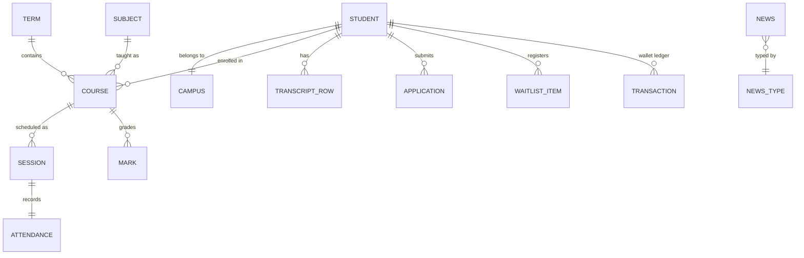

# FAP v2 data model (student view)

Observed 2026-10-04 by read-only GET requests from one student account, in the `en` culture. FAP exposes no JSON for these entities (see [endpoints.md](endpoints.md)); every field below is parsed from HTML. Field names are the `en` labels; all of them localize. Selectors live in [pages.md](pages.md).

"Unverified" marks a shape that this account could not render (empty list, closed window). Re-check it when the account has data.

## Domain map

## User, role, campus

**Student** (`/Account`, ten cards, values in `.student-profile-field__value`; label is the preceding sibling):

| Card | Fields |
|---|---|
| Identity | Roll number, Last name, Middle name, First name, Date Of Birth, Gender, Ethnicity, Religion, Nationality (code) |
| Other | Campus, Donor / Parent access, Remove 04, Created at, Updated at |
| Academic | Major, Specialization, Batch, Class, Curriculum code, Description, Current term (number), Program mode, Status, In / out status, Term initiation, Seven-year term, Former major, Finance type (number), Exam code, High school diploma |
| Personal & contact | Email, Other email, Phone Number, Home phone, Address, Province / city, Ward |
| National ID / passport | National ID, Issue date, Place of issue, Passport, Passport expiry |
| Parents / guardians | Parent name, Parent job, Workplace, Parent phone, Parent email, Parent address |
| Health insurance | Health insurance number, Registered medical facility, Valid from, Valid to |
| Capstone project | Capstone / thesis, Capstone (Vietnamese), Thesis updated on |

The hero card (`.student-profile-hero`) and the "Parent login" and "Change FeId password" cards carry no data fields. `/StudentProfile` edits seven of these fields (listed in [endpoints.md](endpoints.md)); the rest are read-only there.

Smaller copies: the topbar user (`.fap-topbar-user`: name, roll number) and the home card (`.fap-home-student-card`: name, roll, four `__metric` label/value pairs including email and a number, and `__wallet-amount`).

**Role.** No role field, role switcher or role badge is rendered for a student. The only roles visible are implied by routes: staff routes such as `/Academic/ApplicationTypes/OptionsProxy` return 404 to students ([platform.md](platform.md)). Treat the session as single-role.

**Campus.** Display only, in `.jidox-campus-topbar`: `__static` shows `<campus name> (<code>)`, `__info` adds the code and `- Primary`. No campus menu items, no `data-campus-*` attributes, no switch endpoint. The Account "Campus" field holds the same value. Campus code (`HCM` observed) is the only stable key.

## Course, class, schedule, room

| Entity | Key | Fields | Read from |
|---|---|---|---|
| Term | `{guid}` (option value) | name such as `Fall2026` (`<Season><Year>`) | `#grade-report-term`, `#attendance-report-term`, `select#termId` |
| Subject | `{guid}` (`/Subject/Detail/{guid}`); code such as `HCM202` | list: No., Subject Code, Subject Name plus Vietnamese name in one cell, Is Graduate, Is Graded, Take Attendance (check mark), Fee VND, FeeIS, Action. Detail: Subject Code, Short Name, Subject Name, Subject Name Vn, Same Subject, Number Of Students, Fee VND, FeeIS, Created at | `/Subject`, `/Subject/Detail/{guid}` |
| Course (class) | `{guid}` (option value), with `data-report-term-id` | option text `Subject name (CODE) (Group)`, for example `HCM Ideology (HCM202) (Half1_GD1805)` | `#grade-report-course`, `#attendance-report-course` |
| Group | text only | `Half1_GD1805`, `FA26SE159_GFA55`; no id, no roster (see [endpoints.md](endpoints.md)) | course option, timetable cell, attendance row |
| Session (slot) | none | date, slot number, start-end time, room, lecturer login, online flag, schedule type, attendance status | timetable cell; attendance row |
| Room | text only | building plus number, `NVH 308` | timetable `[title="Room"]`, attendance column Room |

Time formats differ by page: timetable `15h00-17h15`, attendance `15:00 - 17:15`, exam `10h50-12h20`. Dates: attendance `Wednesday 14/10/2026`, timetable header `Mon (dd/MM)`.

Per-session coverage is shorter than grade coverage. For this account `WeekPartial` had sessions only from 2026-01-05, and the attendance term selector lists 3 terms (Spring2026, Summer2026, Fall2026; 77, 81 and 45 sessions), while the grade term selector lists 10 terms including Fall2025. No route exposes sessions of terms before Spring2026.

The course selector lists the courses of the selected term only (observed 4, 6, 5 and 3 courses over four terms). The grade term selector lists 10 terms; `/CrossClassChange` lists 28.

## Attendance, grade, transcript

**Attendance record** (`/Report/Attendance`, row of `.attendance-session-sheet`): #, Study date, Study slot, Room, Lecturer, Course (group), Status, Comment.

| Status class | `en` text |
|---|---|
| `attendance-status--present` | Present |
| `attendance-status--absent` | Absent |
| `attendance-status--pending` | Not taken |
| `attendance-status--exempt` | Attendance exempt |

Per-course summary `.attendance-summary` (modifier `--ok` observed): `Absent N% (N/N sessions), N sessions not taken.` A threshold-exceeded modifier was not observed.

**Mark** (`/Report/Grade`, `table.student-mark-sheet`): Mark group, Mark name, Weight (%), Final mark, Comment. Row kinds by shape:

| Row | Shape |
|---|---|
| First row of a group | 5 cells, first has `rowspan` (the group name) |
| Further item of a group | 4 cells |
| Group total | 4 cells, `tr.sheet-row-total` (mark name `Total`) |
| Course summary | 4 or 5 cells, `tr.sheet-grand-total` |

Mark group names are free text set per subject (seen: Exercises, Labs, Progress Tests, Assignment, Final Exam, `Final Exam (Resit)`, `FE`, `FE (Resit)`, `PE`, `PE (Resit)`, Outcome N, Active Learning, Attitude, Project, ...). Do not hard-code them; resit groups are recognised by the `(Resit)` suffix.

Course result: `.grade-average` (number with one decimal, empty while studying or when failed) and `.grade-status` (`Status: <text>`), both with modifier `grade-status--studying`, `--passed` or `--failed`.

**Transcript row**: see [pages.md](pages.md) (10 columns; replaced-subject table has 7). Statuses: Passed, Exempt (`bg-success`), In progress (`bg-info`). A failed or not-passed transcript status was not observed (unverified).

## Application, course registration, fee

| Entity | Fields | Read from |
|---|---|---|
| Application type | id, schema, `fixedFeeAmount`, `feeKey`, deadline, `registrationPeriodDisplay` | `GetFormSchema` json, [endpoints.md](endpoints.md) |
| Application | list shape unverified (`No applications yet.`) | `/Application` |
| Waitlist item (đăng ký môn) | No., Subject, Semester, Amount, Class assignment, Active status, Grade improvement, Note, Created at, Actions | `#wishlist-datatable` |
| Registration preview | json fields in [endpoints.md](endpoints.md) (`baseFee`, `finalAmount`, `feePercent`, `canRegister`, `blockReasonCode`, ...) | `/Wishlist/RegistrationPreview` |
| Payable item | shape unverified (empty: `There are no tuition or dormitory items to pay.`, `You have no pending course enrollment fees.`) | `/ShoppingCart`, `/CoursePendingPayment` |
| Transaction | list: No., Receipt No., Receipt date, Amount, Student ID, Description, Details. Detail (`.card-body`, `col-sm-3` label, `col-sm-9` value): Amount, Balance before, Balance after, Student ID, Description, Created at, Updated at | `#transaction-datatable`, `/Transaction/Detail/{guid}` |
| Wallet balance | number | `GetBalance` json, home card |

Waitlist enumerations: Class assignment `Assigned` (`badge bg-primary`) or `Not assigned`; Active status `Active` (`bg-success`) or `Cancelled`. These are also the `Status` and `IsActive` filter options. The Actions cell held only a muted text span for an assigned item; the cancel button markup is unverified.

## News, documents, feedback

| Entity | Fields | Read from |
|---|---|---|
| News | list: No., Title, Type, Expires, Pinned, Created at, Details. Detail: `.fap-news-detail-header` (type badge `.fap-news-badge--type`, `.fap-news-detail-title`, `.fap-news-detail-meta__item`), body `.fap-news-content`, share button with `data-news-title`, `data-news-url`. Attachments resolve through `data-cdn-base-url`, `data-cdn-url-pattern`, `data-token-endpoint`, `data-project` | `/News`, `/News/Detail/{guid}` |
| News type | `{guid}`; observed `Thông báo tài chính`, `Thông tin chung`, `Thông tin Đào tạo`, `Thông tin Khảo Thí` (names are data, not localized) | `select[name=FAPNewsTypeId]` |
| Document | list: No., Name, Type, File, Active, Audience, Created at, Details | `/Document` |
| Document type | `Nội quy`, `Phần Mềm Thi`, `Quy chế Đào tạo`, `Quy định Tài chính`, `User Guide`, `Văn bản - Chính sách` | `select[name=DocumentTypeId]` |
| Feedback session | counters Pending forms, Submitted forms, Total opened forms; form shape unverified (`There is no opened feedback session for your classes at the moment.`) | `/Feedback` |

`/Feedback` uses its own layout (`.feedback-layout-root`, `.feedback-layout-sheet`) without the sidebar, because `base.js` sends students there when `X-Feedback-Required` is set ([scripts.md](scripts.md)). FYE mentor feedback fields are in [endpoints.md](endpoints.md).

### Mark sheet summary rows and bonus (verified 2026-10-10, 53 sheets over 10 terms)

- Every sheet ends with three `tr.sheet-grand-total` rows: an empty first cell, a `td.text-end` label and a value: `Late penalty (%)` (colspan 2, `0%` on every sheet seen), `Mark bonus` (`-`, `0` or `1`), `Course total` (`Average`, `.grade-average`, `.grade-status`). Item rows of a group follow the first row that carries `td.sheet-group-cell` with `rowspan`. A missing mark is `-`.
- `(Resit)` groups repeat the item name with a `(Resit)` suffix (`Final Exam (Resit)`, `PE (Resit)`, `TE (Resit)`). A graded resit replaces the original score (`ENW493c`: PE 0.0, PE resit 6.2, average 6.2).
- Course total = min(10, weighted average + mark bonus), shown with one decimal, half up (`PMG201c` 7.45 + 1 shows 8.5; `DXD391c` 9.2 + 1 shows 10.0). The bonus is the MOOC completion point of Coursera subjects.
- A course can fail with an average of 5 or more: `CSD201` Spring2025, average 5.3, `grade-status--failed`, Practical Exam 0.
- Some sheets have only the summary rows: courses not yet graded (current term), and result-only courses (`WED201c`, `SSL101c`, `OTP101` with an average; `TRS601` exempt). `LAB211` lists items but no average (not scored).
- Status `Exempt` uses `grade-status--passed`.
- A fast run of about 110 `/Report/Grade` GETs in a few minutes was followed by HTTP 403 on further fetches from the same tab (2026-10-10); cause not determined (rate limit or session end). Pace grade reads.
